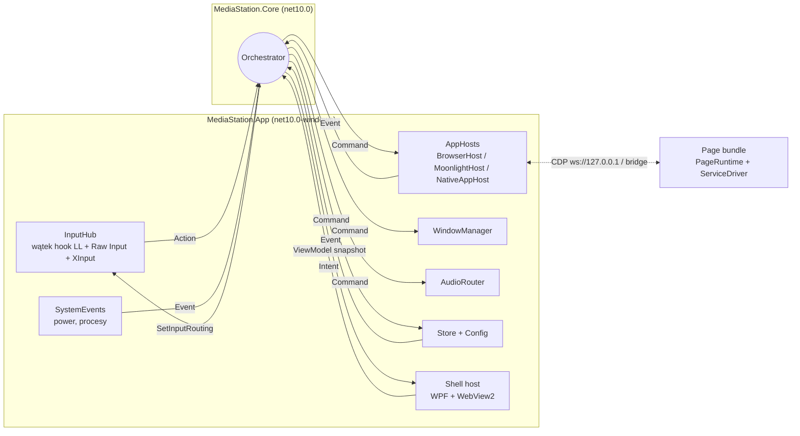
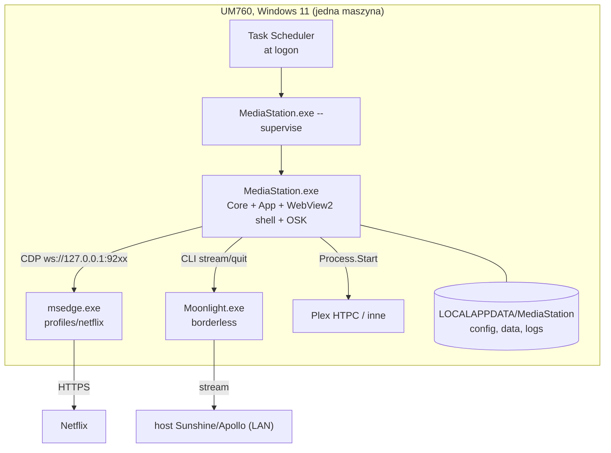

# Architecture Spine: MediaStation MVP

## Design Paradigm

**Hexagonal (ports & adapters) z jednowątkowym actor core.** `Orchestrator` to jedyny writer stanu sesji. Wykonawcy (AppHosts, WindowManager, AudioRouter, InputHub, SystemEvents, Store) implementują porty: wykonują komendy i raportują fakty jako zdarzenia, ale niczego nie decydują. Shell UI jest widokiem: wysyła intencje i renderuje snapshot stanu.

| Warstwa | Gdzie | Zawiera |
| --- | --- | --- |
| Core | `src/MediaStation.Core` (`net10.0`, bez referencji do Windows) | Orchestrator, stan sesji, polityki (`RatingPolicy`, `BackPolicy`), wszystkie kontrakty: Actions, Intents, Commands, Events, view-model, protokół strony, schematy konfiguracji i `data/`, `ErrorCode` |
| Platform (adaptery portów) | `src/MediaStation.App/Platform/*` | Win32 interop: Input, Window, Audio, System |
| Hosts (adaptery portów) | `src/MediaStation.App/Hosts/*` | BrowserHost (CDP), MoonlightHost, NativeAppHost |
| Store / Config | `src/MediaStation.App/Store`, `Config` | pliki JSON |
| Shell | `src/MediaStation.App/Shell` + `web/shell` | host WPF + WebView2, UI w React |
| Page bundle | `web/page/runtime` + `web/page/drivers/<service>` | PageRuntime + ServiceDriver wstrzykiwane do strony serwisu |



Strzałki to jedyne dozwolone kierunki zależności i komunikacji. Wykonawca nigdy nie woła innego wykonawcy bezpośrednio.

## Invariants & Rules

### AD-1: Mechanizm sterowania przeglądarką: B (hybryda D3) [ADOPTED]

- **Binds:** BrowserHost, page bundle, smoke test
- **Prevents:** powrót do Playwrighta, spatial navigation albo flag, które zmieniają DRM, jakość lub ślad automatyzacji
- **Rule:**
  - BrowserHost uruchamia `msedge.exe`/`chrome.exe` z flagami `--user-data-dir=<profiles\<appId>> --remote-debugging-port=<cdpPort> --no-first-run --no-default-browser-check --autoplay-policy=no-user-gesture-required`, plus jedną flagą trybu okna. Tę flagę ustala pierwsza story epiki BrowserHost (otwarte pytanie), zanim ruszą stories WindowManager i OSK.
  - Steruje surowym CDP po WebSocket: `Page.addScriptToEvaluateOnNewDocument`, `Runtime.addBinding` ponawiany po każdej nawigacji głównej ramki, `Input.dispatchKeyEvent`, `Input.insertText`, `Browser.getVersion`.
  - Zakazane: `Runtime.enable`, Playwright, `--enable-spatial-navigation`, flagi Playwrighta, `--remote-allow-origins`, nasłuch poza `127.0.0.1`.
  - Plan awaryjny C (rozszerzenie) uruchamiamy, gdy przeglądarka zablokuje `--remote-debugging-port` dla niestandardowych profili albo serwis zacznie reagować na CDP. Przejście zmienia tylko most (AD-6).

### AD-2: Jeden proces aplikacji, .NET 10 + WebView2, dedykowane wątki

- **Binds:** all
- **Prevents:** drugi proces z IPC i osobnym cyklem życia; logika natywna w JS; Home zależny od wątku UI; dwie instancje z dwoma hookami i dwoma klientami CDP
- **Rule:**
  - Logika MediaStation działa w jednym procesie `MediaStation.exe` (C#, .NET 10 LTS). WPF jest wyłącznie pustym hostem okna dla WebView2, a UI powstaje w HTML/TS.
  - Jedyny dodatkowy proces to ten sam exe w trybie `--supervise`: minimalny rodzic, który restartuje dziecko po awarii z backoffem i nie ma żadnej innej logiki.
  - Wątki:
    - **UI**: WebView2 i WPF;
    - **Input**: hook `WH_KEYBOARD_LL` + Raw Input + XInput, z własną pętlą komunikatów, nigdy w wątku UI;
    - **Orchestrator**: jedna kolejka, przetwarzanie sekwencyjne;
    - I/O: async (CDP, procesy, pliki).
  - Named mutex wymusza jedną instancję, także dla `--smoke` (AD-13).
  - Zawieszony UI nie może blokować Home.

### AD-3: Orchestrator jest jedynym właścicielem stanu sesji

- **Binds:** all
- **Prevents:** dwóch właścicieli „aktywnej aplikacji”, wyścigi Home, crash i wybudzenia, decyzje podejmowane w hostach albo w UI
- **Rule:**
  - Tylko Orchestrator mutuje:
    - aktywną aplikację;
    - stan cyklu życia każdej aplikacji (AD-10);
    - audio focus;
    - tryb wejścia (`shell` / `app` / `osk`);
    - kolejkę „Do oceny”.
  - Wszystko inne trafia do Orchestratora jako Event, Action albo Intent przez jego kolejkę, a z niego wychodzi jako Command.
  - Polityki (`RatingPolicy`, `BackPolicy`, wybór przy Home) to czyste funkcje w Core, bez I/O.
  - `MediaStation.Core` nie referuje Win32, WebView2, WPF ani systemu plików. Granicę egzekwują referencje projektów.

### AD-4: Wykonawcy wykonują i raportują fakty

- **Binds:** AppHosts, WindowManager, AudioRouter, InputHub, SystemEvents, Store
- **Prevents:** ukryte decyzje produktowe w warstwie Windows lub CDP; nieskorelowane wyniki
- **Rule:**
  - Każdy Command ma `cmdId`. Wykonawca odpowiada `CommandCompleted{cmdId}` albo `CommandFailed{cmdId, errorCode}` (`ErrorCode` to enum w Core) i raportuje fakty jako Events (`ProcessExited`, `CdpLost`, `ForegroundChanged`…).
  - Wykonawca nie zmienia aktywnej aplikacji, nie wycisza z własnej inicjatywy, nie wywołuje innych wykonawców i nie przepuszcza wyjątków przez granicę portu.
  - Tylko BrowserHost rozmawia z CDP: jeden klient CDP na przeglądarkę.

### AD-5: Kolejność przy przełączaniu aplikacji

- **Binds:** Orchestrator, AppHosts, WindowManager, AudioRouter
- **Prevents:** dźwięk z tła, okno ukryte zamiast zminimalizowanego, utrata licencji przy wznowieniu
- **Rule:**
  - Opuszczanie aplikacji: `pause` (web, przez stronę) → `mute` drzewa procesów → `minimize`. **Nigdy `SW_HIDE`** dla przeglądarki [ADOPTED].
  - Aktywacja: `restore` → foreground z odblokowaniem (Alt lub `AttachThreadInput`) [ADOPTED] → `unmute`.
  - Wznowienie odtwarzania nie jest automatyczne: robi je użytkownik przez OK. Ścieżka: `action{ok}` (AD-8), który driver na zapauzowanym `/watch` zamienia na `video.play()`. Przy `page-error` driver przeładowuje `/watch/<id>` [ADOPTED].
  - Audio: słychać tylko aktywną aplikację. AudioRouter wycisza całe drzewo procesów od `rootPid` (AD-15), z `IChannelAudioVolume` jako fallbackiem, i ponawia regułę, gdy w drzewie powstanie nowa sesja audio.
  - Moonlight startuje z `--display-mode borderless --mute-on-focus-loss` [ADOPTED], a AudioRouter i tak obejmuje go regułą.

### AD-6: Page bundle = PageRuntime + ServiceDriver, niezależny od transportu [ADOPTED hedge]

- **Binds:** web/page, BrowserHost, kolejne serwisy
- **Prevents:** logika serwisu w C#, kod zależny od CDP w driverze, dwa silniki fokusu
- **Rule:**
  - Do strony trafia jeden plik IIFE (vanilla TS, bez frameworka): wspólny **PageRuntime** (silnik fokusu, własne podświetlenie, `bridge.send/receive`, buforowanie komunikatów do czasu pojawienia się bindingu, nasłuch `<video>` i `focusin`) + jeden **ServiceDriver** (selektory, rozpoznawanie ekranów, reguła Back, metadane playera, ekran profili i limitu, bezpieczna strona przed zamknięciem).
  - Driver komunikuje się wyłącznie przez API PageRuntime, nigdy przez CDP ani `window.__*` hosta.
  - PageRuntime ignoruje surowe zdarzenia D-pada z klawiatury. Nawigację steruje wyłącznie przez `action` (AD-7, AD-8).
  - Nowy serwis = katalog `web/page/drivers/<service>/` z `manifest.json` (`service`, dopasowanie URL-i, start URL, wersja drivera). Start URL istnieje tylko tutaj. Kod hosta się nie zmienia.

### AD-7: Protokół strony v1

- **Binds:** PageRuntime, BrowserHost, Orchestrator, RatingPolicy
- **Prevents:** niezgodne kształty i jednostki komunikatów; spóźniona odpowiedź mieszająca się z nową; zawieszona strona blokująca wyjście
- **Rule:**
  - Koperta: `{ v: 1, type, id?, payload }`. Host odrzuca inny major `v`: loguje i oznacza kafelek stanem błędu.
  - Każdy komunikat host → page ma `id`, a odpowiedź go powtarza. Odpowiedź z nieaktualnym `id` jest ignorowana.
  - Pola opcjonalne są zawsze obecne: brak wartości to `null`, a nie pominięte pole.
  - Komunikaty:

    | Kierunek | `type` | `payload` |
    | --- | --- | --- |
    | host → page | `action` | `{ key: up\|down\|left\|right\|ok }` |
    | host → page | `back` | odpowiedź: `backResult { handled: bool }` |
    | host → page | `pause`, `resume` | — |
    | host → page | `prepareClose` | odpowiedź: `closeReady`, gdy driver przejdzie na bezpieczną stronę (Netflix: `/browse`) |
    | page → host | `hello` | `{ service, driverVersion }`, po każdej nawigacji |
    | page → host | `screen` | `{ name: profiles\|browse\|modal\|title\|search\|watch\|limit\|error, root: bool }` |
    | page → host | `playback` | `{ state: playing\|paused\|ended\|error, position, duration, title, kind: film\|episode, videoId, seriesId, season, episode, lastInSeason }` |
    | page → host | `textFocus` | `{ active: bool }` |
    | page → host | `trustedKey` | `{ key }`, prośba o zaufany klawisz przez CDP (np. `f` dla pełnego ekranu, klawisze playera) |

  - Kształty i jednostki `playback`:
    - `position` i `duration` są w sekundach (float), a `duration` musi być skończona i > 0, inaczej komunikat nie trafia do `RatingPolicy`;
    - `season` i `episode` to liczby całkowite ≥ 1 albo `null`;
    - `lastInSeason` to `bool` albo `null`;
    - komunikat idzie przy każdej zmianie `state` i co ~30 s w stanie `playing`.
  - Back w aplikacji webowej: decyzja wynika **tylko** z `backResult` albo z timeoutu ~500 ms. `handled:false` wtedy i tylko wtedy, gdy ekran jest `root`. `handled:false` albo timeout oznacza przejście do ekranu głównego MediaStation.
  - `prepareClose` bez `closeReady` w ~3 s: host zamyka mimo to.
  - `textFocus` z aplikacji, która nie jest aktywna, jest ignorowany.
  - Pola dodaje się wstecznie zgodnie. Zmiana niezgodna podnosi `v`.

### AD-8: Wejście = Actions, routing z lokalną kopią trybu

- **Binds:** InputHub, Orchestrator, Shell UI, OSK, PageRuntime
- **Prevents:** dwie ścieżki D-pada w webie; hook czekający na Orchestrator (Windows usuwa hook po `LowLevelHooksTimeout`); zawieszone klawisze; podwójne Actions; pętla własnych `SendInput`; UI czytający surowe klawisze
- **Rule:**
  - InputHub zamienia źródła na **Actions** `{ kind: Up|Down|Left|Right|Ok|Back|Home|Keyboard|AppMenu, phase: press|repeat|long, source, tsMono }`.
  - **Jedno naciśnięcie daje jedną Action.** Wyzwalaczem jest VK z hooka LL, a Raw Input służy tylko do identyfikacji urządzenia.
  - Własne `SendInput` (OSK, `back: key:<VK>`, odblokowanie foreground) mają znacznik w `dwExtraInfo` i hook je ignoruje. Flagi `LLKHF_INJECTED` samej w sobie nie ignorujemy, bo Home z pilota ją ma.
  - InputHub jest właścicielem timingu (repeat, long-press).
  - Mapowanie jest w `config/input.json`, kluczowane sygnaturą urządzenia i kodem.
  - Orchestrator wysyła `SetInputRouting{ mode, appType, pointer, epoch }`. Hook decyduje na podstawie lokalnej kopii, bez blokowania. Key-up idzie za decyzją podjętą dla swojego key-down.
  - Tabela routingu:

    | Tryb / typ aktywnej aplikacji | D-pad, OK | Back | Home, Keyboard | Mysz/żyroskop |
    | --- | --- | --- | --- | --- |
    | `shell` (ekran główny) | połykane → Action do Shell | połykane → Action | połykane | wg `pointer` (domyślnie blokowana, kursor ukryty) |
    | `osk` | połykane → OSK | połykane → zamyka OSK | połykane | blokowana |
    | `app` + `web` | połykane → `action` do strony | połykane → `back` do strony | połykane | wg `pointer` (domyślnie blokowana) |
    | `app` + `moonlight` / `native` | przechodzą do aplikacji | połykane → polityka `back` (`home` \| `key:<VK>`) | połykane | wg `pointer` (domyślnie dozwolona) |

  - `AppMenu` istnieje tylko w trybie `shell` (np. long-press OK na kafelku).
  - Gamepad w Moonlight jest przepuszczany w całości. Home z pada to konfigurowalna kombinacja.
  - Shell UI i OSK konsumują **wyłącznie** Actions z core.

### AD-9: Jedna klawiatura ekranowa w MediaStation

- **Binds:** OSK, InputHub, BrowserHost, NativeAppHost
- **Prevents:** dwie implementacje klawiatury; kradzież fokusu z pola tekstowego; wyciek wpisywanego tekstu
- **Rule:**
  - OSK to okno nakładki MediaStation (topmost, `WS_EX_NOACTIVATE`). Fokus zostaje w aplikacji docelowej.
  - Pokazanie OSK przełącza tryb na `osk`, a Back ją zamyka (AD-8).
  - Każdy znak trafia do aplikacji od razu, bez bufora: CDP `Input.insertText` (web) albo `SendInput` Unicode (natywne). Tekst nie trafia do logów, Intents ani view-modelu.
  - W serwisach webowych OSK pokazuje się automatycznie na `textFocus{active:true}` aktywnej aplikacji, a w pozostałych aplikacjach przełącza ją Action `Keyboard`.
  - Fallback, jeśli nakładka nad pełnoekranowym Edge zawiedzie: dla webu OSK rysowana przez PageRuntime, z tym samym trybem `osk` i tymi samymi Actions.

### AD-10: Cykl życia aplikacji i odporność

- **Binds:** Orchestrator, AppHosts, SystemEvents, `--supervise`
- **Prevents:** zabijanie żywej przeglądarki po restarcie MediaStation; martwy kafelek po wybudzeniu; niespójne stany
- **Rule:**
  - Stany per aplikacja: `NotRunning → Starting → Foreground ⇄ Background → Stopping → NotRunning`. Do `Failed` prowadzą timeout, zakończenie procesu albo utrata CDP bez możliwości reconnectu.
  - Wyjście z `Failed` tylko przez `AppMenu` (zamknij / uruchom ponownie).
  - Aplikacje startują leniwie, dopiero po wybraniu kafelka.
  - **Adopcja sierot przy starcie:** Orchestrator wysyła `ProbeExisting` do każdego hosta.
    - Jeśli na `cdpPort` aplikacji odpowiada przeglądarka z jej profilem (albo żyje proces Moonlighta), host się podpina i raportuje `AppWindowAttached`.
    - Adoptowana aplikacja ląduje w `Background`, a na wierzchu jest ekran główny.
  - **Wybudzenie z Modern Standby:** Orchestrator przechodzi na ekran główny i wysyła `RenewSession` do BrowserHost (CDP + `addBinding`). Driver obsługuje wybór profilu [ADOPTED].
  - **Zerwane CDP przy żywym procesie:** reconnect z backoffem.
  - **Zamknięcie przeglądarki:** `prepareClose` → `closeReady` (AD-7) → zamknięcie [ADOPTED].
  - **Moonlight:** `quit` z limitem 30 s, potem MediaStation sama zamyka klienta [ADOPTED].
  - **Restart MediaStation po awarii** robi `--supervise` (AD-2). Stan sesji nie jest trwały: po restarcie start od ekranu głównego plus adopcja.

### AD-11: Rejestr aplikacji i konfiguracja w danych

- **Binds:** Config, AppHosts, Shell UI, Store, logi
- **Prevents:** tabela „serwis → przeglądarka” w kodzie; rozjechane identyfikatory aplikacji; kolizje portów; dwa schematy jednego pliku
- **Rule:**
  - Konfiguracja to trzy pliki w `config/`. Ich schematy to rekordy w Core, a nieznane pola są odrzucane.
    - `apps.json` zawiera wpisy `{ id, type: web|moonlight|native, title, icon, back, pointer, … }`:
      - `web`: `{ service, browser: edge|chrome, cdpPort }`, czyli tabela „serwis → przeglądarka” żyje tutaj;
      - `moonlight`: `{ host, app }`;
      - `native`: `{ exe, args }`.
    - `input.json` zawiera mapowanie wejścia.
    - `settings.json` zawiera wartości polityk (np. `ratingPendingDays`, timeouty).
  - `appId` to jedyny identyfikator aplikacji w całym systemie: profil `profiles\<appId>`, logi, stan.
  - `cdpPort` mieści się w zakresie 9220–9239 i jest unikalny.
  - Walidacja przy starcie. Błąd konfiguracji daje czytelny ekran błędu w shellu, a nie crash.

### AD-12: Trwały stan „Do oceny”

- **Binds:** Orchestrator, RatingPolicy, Store, ServiceDriver, Shell UI
- **Prevents:** dwóch writerów; duplikaty kart; fałszywe karty w trakcie sezonu; utrata „raz na zawsze” po „Pomiń”
- **Rule:**
  - Driver dostarcza fakty (`playback`, AD-7) i **musi** podawać `seriesId`, gdy da się go ustalić. Decyduje `RatingPolicy` w Core:
    - film trafia do kolejki, gdy `position/duration ≥ 0.9`;
    - serial trafia, gdy `lastInSeason == true` i odcinek osiągnie `≥ 0.9`;
    - `lastInSeason == null` → rekord `pending`. Karta pojawia się po `ratingPendingDays` dniach bez kolejnego odcinka ≥ 0.9. Sprawdzenie odbywa się przy starcie i raz na dobę (AD-14).
  - Klucz `<service>:<kind>:<id>` (`kind` = `film|series`) liczy i normalizuje **wyłącznie** `RatingPolicy`. Dla filmu `id` = `videoId`, dla serialu `seriesId`, a gdy go brak, znormalizowany tytuł. Duplikat przy różnych językach profilu to zaakceptowane ryzyko.
  - Rekordy mają `status: pending|queued|rated|skipped` i **nigdy nie są usuwane**. Klucz trafia do kolejki raz na zawsze.
  - Store to tylko persystencja:
    - przy starcie emituje `StoreLoaded`;
    - potem przyjmuje wyłącznie komendę `Persist` z całym dokumentem: `data/rating-queue.json` z `schemaVersion`, zapis atomowy (temp + replace).
  - MediaStation nie przechowuje żadnego konta Filmwebu.

### AD-13: Envelope operacyjny

- **Binds:** build, deploy, środowiska, testy, logi, smoke, bezpieczeństwo
- **Prevents:** wymóg pełnego wydania przy poprawce drivera; harness rozjechany z produktem; logowanie wpisywanego tekstu; niezauważona aktualizacja przeglądarki
- **Rule:**
  - **Build:**
    - `global.json` przypina SDK 10.0.4xx (`rollForward: latestFeature`);
    - build web (Node 24 LTS, npm) działa jako target MSBuild przed `dotnet publish` self-contained win-x64;
    - page bundle trafia jako pliki do `<install>/page/`.
  - **Deploy:**
    - `tools/install.ps1` kopiuje build do `%LOCALAPPDATA%\Programs\MediaStation`;
    - rejestruje zadanie Task Scheduler „at logon” (tylko zalogowany użytkownik), które uruchamia `MediaStation.exe --supervise`;
    - aktualizacja = ponowne uruchomienie skryptu.
  - **Podział z autorem:** autologowanie, ukrycie pulpitu i polityka Windows Update są poza produktem.
  - **Środowiska:** Debug ładuje shell z Vite dev servera w WebView2, a Release z plików lokalnych. Jedna maszyna docelowa (UM760). Maszyna deweloperska służy do buildu i testów bez Netflixa.
  - **Hotfix drivera:** page bundle jest czytany z dysku przy każdym wstrzyknięciu. Hotfix = podmiana pliku w `<install>/page/` + „uruchom ponownie” z pilota.
  - **Testy:**
    - Core: xunit (polityki i Orchestrator na fake'ach portów z `FakeTimeProvider`);
    - drivery: vitest na zapisanych fixture'ach DOM Netflixa;
    - zgodność kontraktów zapewniają typy generowane (AD-16).
  - **Logi:**
    - JSON Lines, UTC, rotacja dzienna, w `%LOCALAPPDATA%\MediaStation\logs`;
    - zdarzenia strony trafiają do tego samego logu z polem `src`;
    - InputHub loguje tylko Actions;
    - surowe kody loguje wyłącznie tryb `--calibrate-input`, i tylko dla klawiszy możliwych z pilota;
    - tekst z OSK nigdy nie jest logowany.
  - **Smoke:**
    - `MediaStation.exe --smoke <appId>` wymaga zatrzymanej instancji głównej (mutex, AD-2);
    - używa prawdziwego BrowserHost i drivera: start, `hello`, profil, odtworzenie ≥ 1080p bez błędu DRM, pauza, reguła Back;
    - zwraca raport i kod wyjścia.
  - **Aktualizacja przeglądarki:** BrowserHost zapisuje `Browser.getVersion` przy podpięciu, a zmiana wersji daje wpis `BrowserVersionChanged` w logu. Po takiej zmianie autor uruchamia smoke.
  - **Port CDP** tylko na loopbacku. Ryzyko przejęcia profilu przez lokalny proces jest zaakceptowane.

### AD-14: Przejścia, korelacja i czas w Core

- **Binds:** Orchestrator, wszyscy wykonawcy
- **Prevents:** zablokowany Home przez `await` w pętli Orchestratora; spóźniony wynik nadpisujący nowszą decyzję (Home w trakcie `Starting`, wybudzenie w trakcie przełączania); timery bez właściciela
- **Rule:**
  - Commands są fire-and-forget. Orchestrator nigdy nie czeka (`await`) w handlerze i nie wykonuje blokujących wywołań Win32 na swoim wątku.
  - Każde przełączenie ma `transitionId`, a nowsza decyzja zastępuje poprzednią. Wyniki ze starego `transitionId` są ignorowane, a gdy trzeba, Orchestrator wysyła komendy kompensujące (np. `minimize` dla aplikacji, która dokończyła start po Home).
  - Hosty nigdy same nie przywracają okna ani nie przenoszą go na wierzch, także po starcie.
  - Czas wchodzi do Core wyłącznie przez `TimeProvider`. Każdy timeout (Back, `Starting`, potwierdzenie `pause`, `prepareClose`, dobowe sprawdzenie `pending`) to `TimerElapsed`, zaplanowany przez Orchestrator.
  - Kolejka snapshotów do Shell trzyma tylko najnowszy snapshot (latest-wins), więc zawieszony UI nie blokuje core.

### AD-15: Tożsamość okien i procesów, jeden właściciel foreground

- **Binds:** AppHosts, WindowManager, AudioRouter, Shell, OSK
- **Prevents:** dwa komponenty szukające tego samego okna różnymi metodami; brak korzenia drzewa procesów po adopcji; konkurencyjne `SetForegroundWindow`
- **Rule:**
  - AppHost po starcie albo adopcji raportuje `AppWindowAttached{ appId, hwnd, rootPid }`. WindowManager i AudioRouter działają tylko na `hwnd` i `rootPid` podanych w Command.
  - **WindowManager to jedyny kod**, który zmienia widoczność, Z-order i foreground dowolnego okna, w tym shella i OSK.
  - WindowManager raportuje `ForegroundChanged`, także gdy okno na wierzchu zmieni się bez jego udziału, a Orchestrator decyduje, co dalej.

### AD-16: Jedno źródło kontraktów Shell ↔ Core i page ↔ host

- **Binds:** Core, Shell UI (React), PageRuntime, BrowserHost
- **Prevents:** ręcznie pisane, rozjechane typy TS i C#; fokus UI zależny od indeksów, które się przesuwają
- **Rule:**
  - View-model, Intents, protokół strony i schematy konfiguracji to rekordy w Core.
  - JSON Schema eksportuje `System.Text.Json` (`JsonSchemaExporter`), a typy TS generuje `json-schema-to-typescript` w buildzie web. Ręczna edycja wygenerowanych typów jest zakazana.
  - Serializacja: camelCase, enumy jako stringi, jawne `null`.
  - Most UI ↔ core to WebView2 `postMessage` z kopertą `{ v, type, payload }`. Core wysyła **pełny snapshot** z monotonicznym `rev`, a UI odrzuca snapshot ze starszym `rev`.
  - UI jest właścicielem tylko efemerycznego stanu nawigacji (fokus, scroll), kluczowanego stabilnymi id (`appId`, klucz „Do oceny”), nigdy indeksami.

## Consistency Conventions

| Concern | Convention |
| --- | --- |
| Nazwy komponentów | Orchestrator, InputHub, WindowManager, AudioRouter, SystemEvents, BrowserHost, MoonlightHost, NativeAppHost, Store, Shell, OSK, PageRuntime, ServiceDriver. Słowo „Adapter” nie oznacza kodu serwisu |
| Komunikaty w Core | `Action` (z wejścia), `Intent` (z UI), `Command` (z Orchestratora, tryb rozkazujący: `MinimizeWindow`), `Event` (fakty, czas przeszły: `ProcessExited`); rekordy C# w `MediaStation.Core` |
| Koperta JSON | `{ v, type, id?, payload }`, `type` w camelCase; ten sam kształt w moście WebView2 i w protokole strony |
| Identyfikatory | `appId` z `apps.json` (kebab-case, np. `netflix`); klucze „Do oceny” `<service>:<kind>:<id>`; `cmdId`, `transitionId` generuje Orchestrator |
| Czas | UTC ISO-8601 w logach i `data/`; `tsMono` (monotoniczny) w Actions; jednostki protokołu strony w sekundach |
| Pliki | `%LOCALAPPDATA%\MediaStation\{config,data,profiles\<appId>,logs}`; każdy plik w `data/` ma `schemaVersion` i zapis atomowy |
| Błędy | `CommandFailed{cmdId, errorCode}` z enumem `ErrorCode` w Core; o stanie `Failed` decyduje Orchestrator |
| Interop Win32 | tylko w `Platform/*`, przez CsWin32; C# i JS ze spike'u to referencja zachowania, nie kod do skopiowania bez przeglądu |

## Stack

| Name | Version |
| --- | --- |
| .NET (LTS) | 10.0.13 runtime / SDK 10.0.402 |
| WPF (host okna) | z .NET 10 (`net10.0-windows`) |
| Microsoft.Web.WebView2 | 1.0.4258.31 |
| Microsoft.Windows.CsWin32 | 0.3.363 |
| xunit.v3 | 4.0.2 |
| Node.js (LTS) + npm | 24.22.0 |
| React | 19.3.1 |
| Vite | 8.3.4 |
| TypeScript | 6.0.3 (7.x dopiero, gdy typescript-eslint go obsłuży) |
| esbuild (page bundle IIFE) | 0.28.2 |
| vitest | 5.0.5 |
| json-schema-to-typescript | 16.0.0 |
| Microsoft Edge (Netflix) / Chrome | stable, kanał evergreen (155 w spike'u) |
| Moonlight-qt | 6.2.0 |
| Windows 11 | 26H2, build 26300 |

## Structural Seed

```text
mediastation/
  global.json
  src/
    MediaStation.Core/          # net10.0: Orchestrator, stan, polityki, wszystkie kontrakty; bez Windows
    MediaStation.App/           # net10.0-windows: composition root, --supervise, --smoke, --calibrate-input
      Platform/Input|Window|Audio|System/
      Hosts/Browser|Moonlight|Native/
      Shell/                    # WPF + WebView2, most postMessage, okno OSK
      Store/  Config/  Logging/  Smoke/
  web/
    contracts/                  # typy TS generowane z JSON Schema Core (nie edytować)
    shell/                      # React + Vite → zasoby Shell
    page/runtime/               # PageRuntime
    page/drivers/netflix/       # ServiceDriver + manifest.json + fixtures/
  tests/MediaStation.Core.Tests/
  tools/install.ps1
  spike/                        # zamrożona referencja, nie budowana
```



## Zakres MVP → architektura

| Pozycja | Lives in | Governed by |
| --- | --- | --- |
| Ekran główny pilotem, klawiaturą i gamepadem, bez kursora | Shell UI, InputHub | AD-2, AD-8, AD-16 |
| Kilka aplikacji naraz, przełączanie bez zamykania | Orchestrator, AppHosts, WindowManager | AD-3, AD-5, AD-10, AD-14, AD-15 |
| Audio focus | AudioRouter | AD-5, AD-15 |
| Pełna integracja Netflixa | BrowserHost, PageRuntime, driver `netflix` | AD-1, AD-6, AD-7 |
| Klawiatura ekranowa | OSK, InputHub | AD-8, AD-9 |
| Moonlight: start, Home chowa i wycisza | MoonlightHost | AD-5, AD-10 |
| Plex i natywne: start i powrót | NativeAppHost | AD-8 (`back`), AD-11 |
| Home zawsze działa, także przy ukradzionym fokusie | InputHub (wątek), WindowManager | AD-2, AD-8, AD-15 |
| Zamknij / uruchom ponownie z pilota | `AppMenu` w Shell, Orchestrator | AD-8, AD-10 |
| „Do oceny” | driver `netflix`, `RatingPolicy`, Store, Shell UI | AD-7, AD-12 |
| Start po logowaniu i restart po awarii (decyzja spine'u, zmienia brief) | `tools/install.ps1`, `--supervise` | AD-2, AD-13 |

## Deferred

| Pozycja | Dlaczego może czekać / gdzie wraca |
| --- | --- |
| S12: Prime Video, HBO Max, Disney+ | Kolejny driver + wpis w `apps.json` (AD-6, AD-11). Tabela „serwis → przeglądarka” czeka na pomiar |
| HDR, Atmos, przełączanie trybów obrazu na TV | Wymaga testu na TV. Nie dotyka granic: ewentualny DisplayManager to nowy wykonawca |
| D-pad w Plexie i aplikacjach natywnych | Kolejna inicjatywa. Routing per `appType` (AD-8) przyjmie nowy wiersz |
| Przełącznik aplikacji pod przytrzymaniem Home | Nowa Action z `phase: long`. Stan aplikacji już ma Orchestrator |
| Widgety, kafelki Moonlight per host i gra | Rozszerzenie `apps.json` i Shell |
| Toast z QR nad playerem | Wykorzysta mechanizm nakładki z AD-9 i WindowManager (AD-15) |
| Mapowanie przez Wikidata | Zmienia tylko cel URL karty. Wymaga `seriesId`, które protokół ma, ale które może być `null` |
| Automatyczna obsługa awarii (popupy, wylogowanie, sieć) | MVP ręcznie. `screen{limit\|error}` daje już sygnał |
| Tryb uruchomienia jako PWA ze Store (osobna sesja SMTC) | Nie jest potrzebny w MVP, bo pauza idzie przez stronę |
| Prewarm aplikacji przy starcie | MVP startuje leniwie (AD-10) |
| UX ekranu limitu, `ratingPendingDays`, domyślne `back` i `pointer`, mapowanie `AppMenu` | Decyzje `bmad-ux`. Mechanizm już ustalony |
| Mechanizm ustalenia `lastInSeason` i `seriesId` | Wewnętrzna sprawa drivera. Kontrakt jest stały |

**Otwarte pytania z miejscem rozstrzygnięcia:**
- **Tryb okna przeglądarki** (`--app` / `--start-fullscreen` / `--kiosk`): pierwsza story epiki BrowserHost, przed stories WindowManager i OSK.
- **G20S Pro BT:** kody przycisków oraz wybudzanie PC przez Bluetooth (dotąd sprawdzone tylko przez dongle). Pierwsza story epiki wejścia: powtórzenie S10 z `--calibrate-input`.
- **Nakładka nad pełnoekranowym Edge:** pierwsza story epiki OSK.
- **Hook LL we własnym wątku dostaje „down”** także przy MediaStation na wierzchu: prototyp InputHub.
- **Nowe sesje audio po zmianie odcinka:** AudioRouter (AD-5).
- **Pauza dłuższa niż kilka godzin lub przez noc.**
- **Kontrole z forge:** czy QR otwiera aplikację, czy przeglądarkę; język tytułu w wyszukiwarce Filmwebu.
