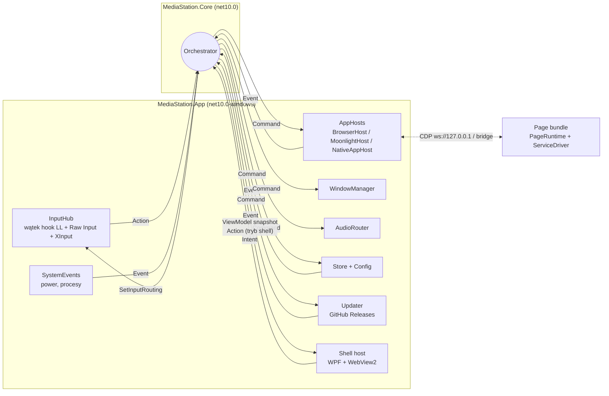
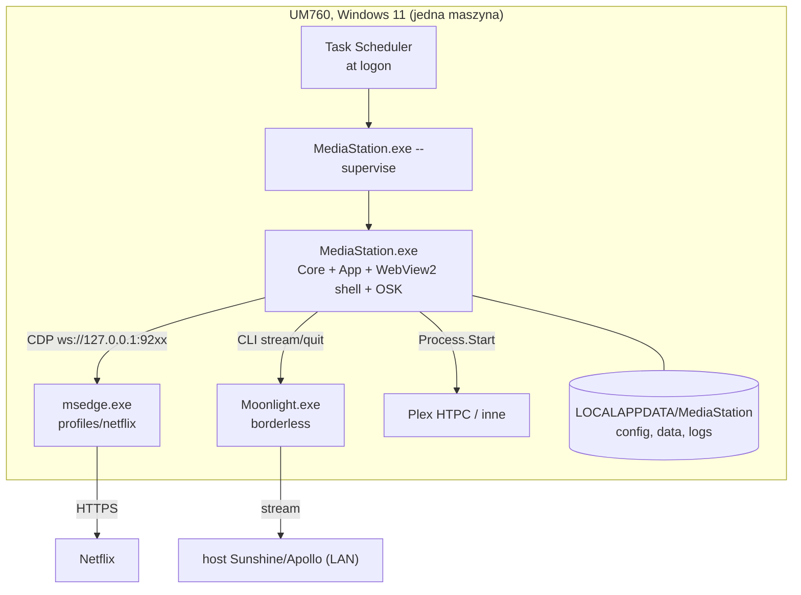

# Architecture Spine: MediaStation MVP

## Design Paradigm

**Hexagonal (ports & adapters) z jednowątkowym actor core.** `Orchestrator` to jedyny writer stanu sesji. Wykonawcy (AppHosts, WindowManager, AudioRouter, InputHub, SystemEvents, Store, Updater) implementują porty: wykonują komendy i raportują fakty jako zdarzenia, ale niczego nie decydują. Shell UI jest widokiem: wysyła intencje i renderuje snapshot stanu.

| Warstwa | Gdzie | Zawiera |
| --- | --- | --- |
| Core | `src/MediaStation.Core` (`net10.0`, bez referencji do Windows) | Orchestrator, stan sesji, polityki (`RatingPolicy`, `BackPolicy`), wszystkie kontrakty: Actions, Intents, Commands, Events, view-model, protokół strony, schematy konfiguracji i `data/`, `ErrorCode` |
| Platform (adaptery portów) | `src/MediaStation.App/Platform/*` | Win32 interop: Input, Window, Audio, System |
| Hosts (adaptery portów) | `src/MediaStation.App/Hosts/*` | BrowserHost (CDP), MoonlightHost, NativeAppHost |
| Store / Config / Update | `src/MediaStation.App/Store`, `Config`, `Update` | pliki JSON; sprawdzanie i pobieranie release'ów (AD-17) |
| Shell | `src/MediaStation.App/Shell` + `web/shell` | host WPF + WebView2, UI w React |
| Page bundle | `web/page/runtime` + `web/page/drivers/<service>` | PageRuntime + ServiceDriver wstrzykiwane do strony serwisu |



Strzałki to jedyne dozwolone kierunki zależności i komunikacji. Wykonawca nigdy nie woła innego wykonawcy bezpośrednio.

## Invariants & Rules

### AD-1: Mechanizm sterowania przeglądarką: B (hybryda D3) [ADOPTED]

- **Binds:** BrowserHost, page bundle, smoke test
- **Prevents:** powrót do Playwrighta, spatial navigation albo flag, które zmieniają DRM, jakość lub ślad automatyzacji
- **Rule:**
  - BrowserHost uruchamia `msedge.exe`/`chrome.exe` z flagami `--user-data-dir=<profiles\<appId>> --remote-debugging-port=<cdpPort> --no-first-run --no-default-browser-check --autoplay-policy=no-user-gesture-required`, plus jedną flagą trybu okna. Tę flagę ustala pierwsza story epiki BrowserHost (otwarte pytanie), zanim ruszą stories WindowManager i OSK.
  - Steruje surowym CDP po WebSocket: `Page.addScriptToEvaluateOnNewDocument`, `Runtime.addBinding` ponawiany po każdej nawigacji głównej ramki, `Input.dispatchKeyEvent`, `Input.insertText`, `Browser.getVersion`.
  - Zakazane: `Runtime.enable`, Playwright, `--enable-spatial-navigation`, flagi Playwrighta, `--remote-allow-origins`, nasłuch poza `127.0.0.1`.
  - Plan awaryjny C (rozszerzenie) uruchamiamy, gdy przeglądarka zablokuje `--remote-debugging-port` dla niestandardowych profili albo serwis zacznie reagować na CDP. Przejście zmienia tylko most (AD-6).

### AD-2: Jeden proces aplikacji, .NET 10 + WebView2, dedykowane wątki

- **Binds:** all
- **Prevents:** drugi proces z IPC i osobnym cyklem życia; logika natywna w JS; Home zależny od wątku UI; dwie instancje z dwoma hookami i dwoma klientami CDP
- **Rule:**
  - Logika MediaStation działa w jednym procesie `MediaStation.exe` (C#, .NET 10 LTS). WPF jest wyłącznie pustym hostem okna dla WebView2, a UI powstaje w HTML/TS.
  - Jedyny dodatkowy proces to ten sam exe w trybie `--supervise`: minimalny rodzic, który restartuje dziecko po awarii z backoffem i wykonuje przełączenie wersji z rollbackiem (AD-17). Nie ma żadnej innej logiki.
  - Wątki:
    - **UI**: WebView2 i WPF;
    - **Input**: hook `WH_KEYBOARD_LL` + Raw Input + XInput, z własną pętlą komunikatów, nigdy w wątku UI;
    - **Orchestrator**: jedna kolejka, przetwarzanie sekwencyjne;
    - I/O: async (CDP, procesy, pliki).
  - Named mutex wymusza jedną instancję, także dla `--smoke` (AD-13).
  - Zawieszony UI nie może blokować Home.

### AD-3: Orchestrator jest jedynym właścicielem stanu sesji

- **Binds:** all
- **Prevents:** dwóch właścicieli „aktywnej aplikacji”, wyścigi Home, crash i wybudzenia, decyzje podejmowane w hostach albo w UI
- **Rule:**
  - Tylko Orchestrator mutuje:
    - aktywną aplikację;
    - stan cyklu życia każdej aplikacji (AD-10);
    - audio focus;
    - tryb wejścia (`shell` / `app` / `osk`);
    - kolejkę „Do oceny”.
  - Wszystko inne trafia do Orchestratora jako Event, Action albo Intent przez jego kolejkę, a z niego wychodzi jako Command.
  - Polityki (`RatingPolicy`, `BackPolicy`, wybór przy Home) to czyste funkcje w Core, bez I/O.
  - `MediaStation.Core` nie referuje Win32, WebView2, WPF ani systemu plików. Granicę egzekwują referencje projektów.

### AD-4: Wykonawcy wykonują i raportują fakty

- **Binds:** AppHosts, WindowManager, AudioRouter, InputHub, SystemEvents, Store
- **Prevents:** ukryte decyzje produktowe w warstwie Windows lub CDP; nieskorelowane wyniki
- **Rule:**
  - Każdy Command ma `cmdId`. Wykonawca odpowiada `CommandCompleted{cmdId}` albo `CommandFailed{cmdId, errorCode}` (`ErrorCode` to enum w Core) i raportuje fakty jako Events (`ProcessExited`, `CdpLost`, `ForegroundChanged`…).
  - Wykonawca nie zmienia aktywnej aplikacji, nie wycisza z własnej inicjatywy, nie wywołuje innych wykonawców i nie przepuszcza wyjątków przez granicę portu.
  - Tylko BrowserHost rozmawia z CDP: jeden klient CDP na przeglądarkę.

### AD-5: Kolejność przy przełączaniu aplikacji

- **Binds:** Orchestrator, AppHosts, WindowManager, AudioRouter
- **Prevents:** dźwięk z tła, okno ukryte zamiast zminimalizowanego, utrata licencji przy wznowieniu
- **Rule:**
  - Opuszczanie aplikacji: `pause` (web, przez stronę) → `mute` drzewa procesów → `minimize`. **Nigdy `SW_HIDE`** dla przeglądarki [ADOPTED].
  - Aktywacja: `restore` → foreground z odblokowaniem (Alt lub `AttachThreadInput`) [ADOPTED] → `unmute`.
  - Wznowienie odtwarzania nie jest automatyczne: robi je użytkownik przez OK. Ścieżka: `action{ok}` (AD-8), który driver na zapauzowanym `/watch` zamienia na `video.play()`. Przy `page-error` driver przeładowuje `/watch/<id>` [ADOPTED].
  - Audio: słychać tylko aktywną aplikację. AudioRouter wycisza całe drzewo procesów od `rootPid` (AD-15), z `IChannelAudioVolume` jako fallbackiem, i ponawia regułę, gdy w drzewie powstanie nowa sesja audio.
  - Moonlight startuje z `--display-mode borderless --mute-on-focus-loss` [ADOPTED], a AudioRouter i tak obejmuje go regułą.

### AD-6: Page bundle = PageRuntime + ServiceDriver, niezależny od transportu [ADOPTED hedge]

- **Binds:** web/page, BrowserHost, kolejne serwisy
- **Prevents:** logika serwisu w C#, kod zależny od CDP w driverze, dwa silniki fokusu
- **Rule:**
  - Do strony trafia jeden plik IIFE (vanilla TS, bez frameworka): wspólny **PageRuntime** (silnik fokusu, własne podświetlenie, `bridge.send/receive`, buforowanie komunikatów do czasu pojawienia się bindingu, nasłuch `<video>` i `focusin`) + jeden **ServiceDriver** (selektory, rozpoznawanie ekranów, reguła Back, metadane playera, ekran profili i limitu, bezpieczna strona przed zamknięciem).
  - Driver komunikuje się wyłącznie przez API PageRuntime, nigdy przez CDP ani `window.__*` hosta.
  - PageRuntime ignoruje surowe zdarzenia D-pada z klawiatury. Nawigację steruje wyłącznie przez `action` (AD-7, AD-8).
  - Własne podświetlenie rysuje według tokenu `focus-ring-injected` z DESIGN.md: biały obrys z ciemną obwódką i promieniem elementu docelowego (`getComputedStyle`, fallback z tokenu), bez skali i bez zmiany layoutu strony. Wartości żyją tylko w DESIGN.md.
  - Ekran `profiles`: driver fokusuje ostatnio używany profil (fallback: pierwszy) i nigdy go nie wybiera. Wybór należy do użytkownika. Sposób zapamiętania ostatniego profilu to wewnętrzna sprawa drivera.
  - Ekrany `limit` i `error`: MediaStation nie dodaje własnego UI. Driver stawia fokus na głównej akcji ekranu (np. „Spróbuj ponownie”).
  - Nowy serwis = katalog `web/page/drivers/<service>/` z `manifest.json` (`service`, dopasowanie URL-i, start URL, wersja drivera). Start URL istnieje tylko tutaj. Kod hosta się nie zmienia.

### AD-7: Protokół strony v1

- **Binds:** PageRuntime, BrowserHost, Orchestrator, RatingPolicy
- **Prevents:** niezgodne kształty i jednostki komunikatów; spóźniona odpowiedź mieszająca się z nową; zawieszona strona blokująca wyjście
- **Rule:**
  - Koperta: `{ v: 1, type, id?, payload }`. Host odrzuca inny major `v`: loguje i oznacza kafelek stanem błędu.
  - Każdy komunikat host → page ma `id`, a odpowiedź go powtarza. Odpowiedź z nieaktualnym `id` jest ignorowana.
  - Pola opcjonalne są zawsze obecne: brak wartości to `null`, a nie pominięte pole.
  - Komunikaty:

    | Kierunek | `type` | `payload` |
    | --- | --- | --- |
    | host → page | `action` | `{ key: up\|down\|left\|right\|ok }` |
    | host → page | `back` | odpowiedź: `backResult { handled: bool }` |
    | host → page | `pause`, `resume` | — |
    | host → page | `prepareClose` | odpowiedź: `closeReady`, gdy driver przejdzie na bezpieczną stronę (Netflix: `/browse`) |
    | host → page | `osk` | `{ active: bool }`, przy pokazaniu i schowaniu OSK (AD-9) |
    | page → host | `hello` | `{ service, driverVersion }`, po każdej nawigacji |
    | page → host | `screen` | `{ name: profiles\|browse\|modal\|title\|search\|watch\|limit\|error, root: bool }` |
    | page → host | `playback` | `{ state: playing\|paused\|ended\|error, position, duration, title, kind: film\|episode, videoId, seriesId, season, episode, lastInSeason }` |
    | page → host | `textFocus` | `{ active: bool }` |
    | page → host | `trustedKey` | `{ key }`, prośba o zaufany klawisz przez CDP (np. `f` dla pełnego ekranu, klawisze playera) |

  - Kształty i jednostki `playback`:
    - `position` i `duration` są w sekundach (float), a `duration` musi być skończona i > 0, inaczej komunikat nie trafia do `RatingPolicy`;
    - `season` i `episode` to liczby całkowite ≥ 1 albo `null`;
    - `lastInSeason` to `bool` albo `null`;
    - komunikat idzie przy każdej zmianie `state` i co ~30 s w stanie `playing`.
  - Back w aplikacji webowej: decyzja wynika **tylko** z `backResult` albo z timeoutu ~500 ms. `handled:false` wtedy i tylko wtedy, gdy ekran jest `root`. `handled:false` albo timeout oznacza przejście do ekranu głównego MediaStation.
  - `prepareClose` bez `closeReady` w ~3 s: host zamyka mimo to.
  - `textFocus` z aplikacji, która nie jest aktywna, jest ignorowany.
  - Pola dodaje się wstecznie zgodnie. Zmiana niezgodna podnosi `v`.

### AD-8: Wejście = Actions, routing z lokalną kopią trybu

- **Binds:** InputHub, Orchestrator, ShellBridge, Shell UI, OSK, PageRuntime
- **Prevents:** dwie ścieżki D-pada w webie; dwa źródła stanu AppMenu (Shell i Orchestrator) i AppMenu, którego Home nie zamyka; hook czekający na Orchestrator (Windows usuwa hook po `LowLevelHooksTimeout`); zawieszone klawisze; podwójne Actions; pętla własnych `SendInput`; UI czytający surowe klawisze; powtórzenie zaobserwowanego na UM760 milczenia hooka przy rejestracji Raw Input klawiatury w tym samym procesie; przycisk Klawiatura bez żadnego przycisku pilota z VK; podwójna Action Home/Back przez mapowanie ich usage HID obok VK
- **Rule:**
  - InputHub zamienia źródła na **Actions** `{ kind: Up|Down|Left|Right|Ok|Back|Home|Keyboard, phase: press|repeat|long, source, tsMono }`. Nie ma `kind` dla AppMenu: AppMenu otwiera Shell z OK (reguła AppMenu niżej), więc `ActionKind.AppMenu` znika z kontraktu, a `"appMenu"` w `input.json` jest odrzucane jak każda nieznana wartość enumu. `Keyboard` daje przycisk pilota z `input.json` (wybrany w `--calibrate-input`) i klawisz konfigurowalny dla klawiatury i pada.
  - **Jedno naciśnięcie daje jedną Action.** Wyzwalaczem jest VK z hooka LL, a Raw Input służy tylko do identyfikacji urządzenia. Jedyny wyjątek to wyzwalacz HID usage dla `Keyboard` (reguła niżej). Autorepeat systemu nie daje kolejnej Action.
  - **Wyzwalacz HID usage dla `Keyboard` [decyzja 2026-10-25, bug 3.14].** Przycisk pilota bez VK może wyzwolić Action `Keyboard` raportem HID Consumer. Na G20S Pro jest to przycisk asystenta głosowego: strona `0x0C`, usage `0x00CF`, bez VK, a Windows nie robi z nim nic (S9, 2026-10-25).
    - **Zakres:** tylko `Keyboard`, tylko urządzenie `source: remote`, tylko strona `0x0C`. Home, Back, OK i strzałki zostają na VK; usage `0x0223` i `0x0224` nie mogą być mapowane, bo ich VK daje już Action i powstałyby dwie.
    - **`input.json`:** urządzenie ma opcjonalną sekcję `hid` obok `keys`: `"hid": { "0x000C:0x00CF": "keyboard" }`. Klucz to `<usagePage>:<usage>` w hex z `0x`, wartość wyłącznie `keyboard`. Walidacja odrzuca: sekcję `hid` na urządzeniu innym niż `remote` (w tym `*`), inną wartość niż `keyboard`, usage `0x0223`/`0x0224`, stronę inną niż `0x000C`, zdublowany klucz oraz drugi klucz `hid` z tą samą Action w obrębie urządzenia. Brak sekcji = brak wyzwalacza HID; sample zawiera wpis `0x000C:0x00CF` dla `VID_1915&PID_1025`.
    - **`source`:** zawsze `remote`. Raport Consumer niesie ścieżkę urządzenia, więc dowodem jest sam raport z podpisanego urządzenia `remote`; korelacja czasowa z VK (okno 50 ms) nie dotyczy tej ścieżki i nie zmienia się dla Home/Back.
    - **Połykanie:** brak. Nie ma VK do połknięcia, Raw Input z `RIDEV_INPUTSINK` niczego nie połyka, a system nie reaguje na usage `0x00CF`. Bramka foreground działa jak dla innych klawiszy: Action tylko przy oknie naszym lub zarządzanym; nad obcym oknem raport jest ignorowany bez Action.
    - **Jedno naciśnięcie:** Action na przejściu „brak → usage” raportu z niezerowym usage; kolejne raporty tego samego usage bez raportu zwolnienia (usage 0) są ignorowane. `Keyboard` nie ma `repeat` ani `long`. G20S Pro wysyła raport zwolnienia po `0x00CF` (zmierzone na UM760, 2026-10-26, HEAD 08eaade, S10 odbioru epiki 3: dwa wciśnięcia w odstępie ok. 4 s dały dwie Action), więc reguła debounce nie obowiązuje; `MaxRepeatHoldMs` (60 s) zostaje tylko siatką na zgubione zwolnienie.
    - Nie dodaje to rejestracji Raw Input: `0x0C/0x01` już działa, a klawiatura nadal jest niezarejestrowana w procesie hooka.
  - InputHub nie rejestruje Raw Input klawiatury (`0x01/0x06`, `RIDEV_INPUTSINK`) w procesie z `WH_KEYBOARD_LL`; pozostawia Raw Input HID Consumer (`0x0C/0x01`) dla korelacji Home/Back. Przeniesienie `WM_INPUT` na inny wątek tego procesu nie spełnia tego warunku. Raportu HID nie używamy jako wyzwalacza Action, poza `Keyboard` z sekcji `hid` (reguła wyżej).
  - `source: remote` wymaga sygnału przypisanego do pilota; dla wstrzykniętego Home/Back korelacja musi łączyć sygnaturę urządzenia, czas i właściwą parę HID Consumer usage → VK (`0x0223` → `VK_BROWSER_HOME`, `0x0224` → `VK_BROWSER_BACK`). Sam VK albo inny raport Consumer nie dowodzi źródła. Bez Raw Input klawiatury zwykłe klawisze pilota (m.in. D-pad i OK) mogą mieć `source: keyboard`, choć nadal dają jedną Action według VK. Nie wolno deklarować ich jako `remote` na podstawie samego mapowania `input.json`. Wyjątek Home nad obcym oknem wymaga potwierdzonego `source: remote`; jeśli fizyczny Home nie spełni tego warunku, wariant nie spełnia AD-8.
  - `--calibrate-input` loguje przyciski pilota przychodzące jako raport HID Consumer (z VK albo bez) i ma zapisać wybrany przycisk Klawiatura do `input.json`: VK do `keys`, usage bez VK do `hid`. OK i strzałki nie przychodzą tym kanałem, więc nie są jego kryterium (decyzja 2026-10-25, wariant (a)). Diagnostyczny odczyt Raw Input klawiatury może działać tylko bez równoczesnego hooka LL w tym samym procesie (np. osobny tryb kalibracji albo proces); nie przywraca tej rejestracji w normalnym InputHub.
  - Własne `SendInput` (OSK, `back: key:<VK>`, odblokowanie foreground) mają znacznik w `dwExtraInfo` i hook je ignoruje. Flagi `LLKHF_INJECTED` samej w sobie nie ignorujemy, bo Home z pilota ją ma.
  - InputHub jest właścicielem timingu (repeat, long-press).
  - Klawisz, który w bieżącym trybie ma przypisane `long` (OK w `shell` i w `osk`), dostaje `press` dopiero na key-up przed progiem long-press. Po osiągnięciu progu InputHub emituje `long` i nie emituje już `press`. Pozostałe klawisze dostają `press` na key-down.
  - **Trzymana strzałka** daje `press` na key-down, a potem `repeat` po `timing.repeatDelayMs` i co `timing.repeatIntervalMs`, aż do key-up. `repeat` dostają wyłącznie strzałki; OK, Back, Home i Keyboard nigdy.
  - Mapowanie jest w `config/input.json`, kluczowane sygnaturą urządzenia i kodem.
  - Orchestrator wysyła `SetInputRouting{ mode, appType, pointer, epoch, clipHwnd? }`. `clipHwnd` jest opcjonalne (`null` = brak ograniczenia): w trybie `osk` niepuste `clipHwnd` ogranicza kursor do prostokąta tego okna (`ClipCursor`) i połyka kliknięcia poza nim, a ograniczenie jest zwalniane przy każdej zmianie trybu. Hook decyduje na podstawie lokalnej kopii, bez blokowania. Key-up idzie za decyzją podjętą dla swojego key-down.
  - **Wskaźnik nigdy nie jest połykany.** Hook `WH_MOUSE_LL` przepuszcza ruch, kliknięcia i kółko w każdym trybie, bo nie rozróżnia urządzeń, a fizyczna mysz musi zawsze działać (wyjście awaryjne). Jedynym wyjątkiem jest kliknięcie poza `clipHwnd` w `osk`. Pole `pointer` jest tylko podpowiedzią kursora dla Shella: `blocked` = kursor ukryty w bezruchu i widoczny po ruchu myszy, `allowed` = widoczny. Żyroskop pilota klika w Shellu jak zwykła mysz [ADOPTED].
  - **Bramka foreground: połykamy tylko na własnych oknach.** Klawisze i Actions z klawiatury i pada są połykane tylko wtedy, gdy okno na pierwszym planie jest nasze albo zarządzane. Przy obcym oknie (pulpit, Explorer, ręcznie otwarty Edge, przełącznik Alt+Tab, UAC) hook przepuszcza klawisz bez Action niezależnie od `mode`, więc PC działa normalnie bez wyłączania MediaStation [ADOPTED].
    - **Wyjątek:** Home z urządzenia `remote` jest połykany i daje `home` nad dowolnym oknem (S6, S9).
    - **Nasze lub zarządzane** to shell, OSK i okna z `AppWindowAttached` (AD-15), dopasowane po `hwnd` najwyższego okna (`GA_ROOT`) foreground, a gdy to nie pasuje, po `rootPid`. Okno otwarte przez użytkownika poza Orchestratorem nie jest zarządzane.
    - Orchestrator wysyła zbiór komendą `SetManagedWindows{ oskHwnd?, apps[{ hwnd, rootPid }], epoch }` (własny licznik `epoch`, przyjmowany tylko gdy większy), a InputHub trzyma lokalną kopię (`ManagedWindows`). Uchwytu shella nie niesie komenda: Core go nie zna, więc App wpisuje go sam (`ManagedWindows.SetShell`) po utworzeniu okna. **Hook sprawdza foreground sam przy key-down** (`GetForegroundWindow` i lookup w kopii), bez czekania na Orchestrator i bez WinEvent, żeby nie było wyścigu po Alt+Tab. Key-up idzie za decyzją key-down. Foreground nieznane lub chwilowe (brak okna, secure desktop) liczy się jako obce.
    - Pad XInput jest odpytywany i nie połyka, a jego Actions podlegają tej samej bramce: kombinacja `gamepadHome` poza naszymi oknami nic nie robi [ASSUMPTION].
    - `mode` opisuje stan MediaStation i nie zmienia się, gdy użytkownik przełączy okno; bramka tylko rozstrzyga, czy tabela poniżej w ogóle obowiązuje.
  - Tabela routingu (obowiązuje przy foreground nasze lub zarządzane; Home z `remote` także poza nim):

    | Tryb / typ aktywnej aplikacji | D-pad, OK | Back | Home | Keyboard | Mysz/żyroskop |
    | --- | --- | --- | --- | --- | --- |
    | `shell` (ekran główny) | połykane → Action do Shell | połykane → Action do Shell | połykane → Orchestrator, potem Action do Shell | połykane → OSK, gdy Shell zgłosił `textFocus{active:true}`; inaczej nic | przechodzi; `pointer` (domyślnie `blocked`) tylko ukrywa kursor w bezruchu |
    | `osk` | połykane → OSK | połykane → OSK (zamyka rząd wariantów, a gdy go nie ma, OSK) | połykane → zamyka OSK i pokazuje ekran główny | połykane → zamyka OSK | dozwolona, kursor ograniczony do okna OSK (`ClipCursor`); kliknięcie poza OSK połykane |
    | `app` + `web` | połykane → `action` do strony | połykane → `back` do strony | połykane | połykane → OSK, gdy strona zgłosiła `textFocus{active:true}`; inaczej nic | przechodzi; `pointer` (domyślnie `blocked`) tylko ukrywa kursor w bezruchu |
    | `app` + `moonlight` / `native` | przechodzą do aplikacji (bez Actions) | połykane → polityka `back` (`home` \| `key:<VK>`) | połykane | połykane → OSK | przechodzi; `pointer` (domyślnie `allowed`) = kursor widoczny |

  - **Actions w trybie `shell`.** Orchestrator przekazuje do Shell komunikatem `action` (AD-16) strzałki (`press`, `repeat`), Ok (`press`, `long`), Back i Home. O przekazaniu D-pada, OK i Back decyduje tryb Orchestratora w chwili obsługi Action. Shell nie dostaje ich w trybach `app` i `osk`.
    - Przekazanie nie jest Commandem (bez `cmdId`, bez `CommandCompleted`): wynik kroku Orchestratora niesie osobną listę Actions dla Shell obok snapshotu, a pętla publikuje najpierw snapshot tego kroku, potem te Actions (kolejność dostarczenia w AD-16).
    - Home Orchestrator najpierw obsługuje jak w każdym trybie (przejście z nowym `transitionId`, AD-14), a potem **zawsze** przekazuje go do Shell, także gdy obsługa nic nie zmieniła. W Shell Home tylko zamyka nakładki (AppMenu) i nie przenosi fokusu. Home na ekranie głównym zachowuje skutek z AD-14: aplikacja w `Starting` nie wyjdzie na wierzch. Zamknięcie AppMenu bez skutków ubocznych daje Back.
  - W pozostałych trybach Orchestrator obsługuje dziś tylko Home: przekazanie `action` i `back` do strony dokłada epika BrowserHost/Netflix, a OSK epic-osk. `Keyboard` nie trafia do Shell i Orchestrator go ignoruje, dopóki epic-osk nie doda bramki `textFocus` (AD-9, DW-17). InputHub emituje `Keyboard` w każdym wierszu tabeli i sam go nie bramkuje.
  - **AppMenu** istnieje tylko w trybie `shell` i należy do Shell:
    - stan otwarcia (które `appId`, fokus w menu) to efemeryczny stan nawigacji Shell (AD-16), nie stan sesji;
    - wyzwalacze rozstrzyga Shell z otrzymanej Action i `state` kafelka ze snapshotu: long-press OK (`phase: long`) na kafelku `Background` albo `Failed`; OK (`press`) na kafelku `Failed`, z fokusem na „Uruchom ponownie”;
    - long-press OK na kafelku `NotRunning`, `Starting` albo `Stopping` nic nie robi, a OK na kafelku `Starting` jest ignorowane;
    - Back zamyka menu z fokusem na kafelku, Home zamyka menu i zostawia ekran główny;
    - Shell sam zamyka menu, bez Intentu, gdy jego aplikacja w snapshocie wyjdzie z `Background` i `Failed`, gdy przyjdzie nowe `focusRequest.seq` (najpierw zamknięcie, potem fokus) albo gdy którakolwiek aplikacja jest `Foreground`;
    - do Orchestratora idą tylko Intents `RestartApp` i `CloseApp` z pozycji menu. Intentu otwierającego AppMenu nie ma;
    - Shell decyduje na podstawie ostatniego snapshotu, a Orchestrator i tak sprawdza każdy Intent wobec własnego stanu (AD-3): `LaunchApp` tylko z `NotRunning` albo `Background`, `RestartApp` i `CloseApp` tylko z `Background` albo `Failed`, zawsze pod warunkiem, że inna aplikacja nie jest aktywna. Inny Intent jest ignorowany z wpisem `intentIgnored` w logu.
  - Shell działa wyłącznie na Actions: kliknięcie i ruch wskaźnika (mysz, żyroskop) nie przenoszą fokusu, nie otwierają AppMenu i nie wysyłają Intents.
  - Gamepad w Moonlight jest przepuszczany w całości: D-pad i OK nie dają Actions, a kombinacja Home z pada daje `home` w każdym trybie. Home z pada to konfigurowalna kombinacja.
  - Shell UI i OSK konsumują **wyłącznie** Actions z core.

**Notes — spike 3.11 (2026-10-24):**
- `Source conflict:` S10 na UM760 dowiódł ścieżki G20S Pro HID Consumer `0x0223` → `VK_BROWSER_HOME` i 16/16 Home nad czterema celami, lecz przypisanie problemu zajętemu wątkowi UI było hipotezą. Na UM760 z wejściem syntetycznym rejestracja Raw Input klawiatury korelowała z brakiem callbacku LL przy własnym oknie na wierzchu; osobny wątek Raw Input, `MS_NO_GATE` i usunięcie WebView2 tego nie naprawiły. Wariant rejestrujący tylko HID Consumer pozostawił hook VK zdolny do jednej Action dla Home/Back/OK w trzech kolejnych przebiegach. Mechanizm Windows i zachowanie fizycznego G20S Pro na UM760 pozostają niepotwierdzone.
- Implementacja: przenieść wariant bez rejestracji klawiatury z gałęzi spike'u do zwykłej ścieżki InputHub; sprawdzić na UM760 przy shellu na wierzchu `keyEnter` down, jedną Action na Home/Back/OK w trzech uruchomieniach, brak `inputHubError` i brak Raw Input klawiatury. Testy polityki muszą pokazać `remote` tylko dla właściwej pary HID Home/Back, `keyboard` przy braku dowodu urządzenia lub obcym usage oraz zachowanie bramki nad obcym oknem. Sprawdzić, że `--calibrate-input` nadal rozpoznaje VK i sygnaturę urządzenia, bez współistnienia rejestracji Raw Input klawiatury i hooka; w testach per-ticket użyć dostępnej klawiatury, a fizyczny przycisk G20S Pro sprawdzić w odbiorze na UM760. Wyniki i logi zapisać w planie ticketu implementacyjnego.
- Oddzielny proces Raw Input klawiatury działający stale, inna korelacja źródła, `RIDEV_NOLEGACY` i `WM_APPCOMMAND` nie są przyjętymi rozwiązaniami: spike ich nie zweryfikował jako całości. Wiersz `source: remote` z `input.json` nie rozpozna zwykłych klawiszy pilota po ich sygnaturze podczas normalnej pracy; scalone mapowanie `kind` po VK może nadal dawać właściwe Actions. Jeśli produkt będzie wymagał `source: remote` także dla tych klawiszy, osobny ticket ma najpierw dowieść kanału identyfikacji i kolejności zdarzeń bez ponownego wyciszenia hooka; do tego czasu jawny fallback `keyboard` jest kosztem decyzji.
- Po dostarczeniu zmiany fizyczny G20S Pro, `VK_BROWSER_HOME`, brak nowego okna przeglądarki, `source` Home/Back i zwykłych klawiszy oraz S10 16/16 sprawdza użytkownik w odbiorze **całej** `epic-input` na UM760 przez `fp-acceptance`. Wynik wejścia syntetycznego nie jest tym odbiorem.

### AD-9: Jedna klawiatura ekranowa w MediaStation

- **Binds:** OSK, InputHub, BrowserHost, PageRuntime, Shell UI, Orchestrator
- **Prevents:** dwie implementacje klawiatury; kradzież fokusu z pola tekstowego; wyciek wpisywanego tekstu; tekst płynący przez kolejkę Orchestratora
- **Rule:**
  - OSK to okno nakładki MediaStation (topmost, `WS_EX_NOACTIVATE`), jedno dla wszystkich aplikacji. Fokus zostaje w aplikacji docelowej.
  - O pokazaniu decyduje Orchestrator, wysyłając `ShowOsk{ target }` i `HideOsk`. Pokazanie przełącza tryb na `osk`, a Back, Home i `Keyboard` ją zamykają (AD-8). Wyzwalacze:
    - `textFocus{active:true}` aktywnej aplikacji webowej (automatycznie, AD-7);
    - Action `Keyboard` w `app` + `web`, gdy pole strony ma `textFocus`, oraz zawsze w `app` + `moonlight` / `native`;
    - Action `Keyboard` w `shell`, gdy Shell UI zgłosił Intent `textFocus{active}` (bez treści pola). W MVP Shell nie ma pól tekstowych.
  - `target` wskazuje drogę wpisywania (`TextSink`):
    - `web(appId)`: BrowserHost, CDP `Input.insertText`;
    - `foreground`: `Platform/Input`, `SendInput` z `KEYEVENTF_UNICODE` do okna na pierwszym planie (Plex, UI Moonlighta, pole Shell). Wstrzyknięcia mają znacznik w `dwExtraInfo`, więc hook je ignoruje (AD-8).
  - OSK wysyła znaki bezpośrednio do `TextSink` z `target`, od razu i bez bufora. To jedyny kanał, który omija kolejkę Orchestratora: tekst nie trafia do logów, Intents, Events ani view-modelu.
  - Pokazanie i schowanie OSK nad aplikacją webową host ogłasza stronie komunikatem `osk{active}` (AD-7). Przy `active:true` PageRuntime przełącza pole docelowe na styl `input-active` (DESIGN.md) i nie rysuje własnego fokusu. Pole aplikacji natywnej zachowuje własny styl, a jedyny fokus MediaStation stoi na klawiszu OSK.
  - OSK konsumuje OK według fazy: `press` wstawia znak, a `long` otwiera rząd polskich wariantów bez wstawiania litery bazowej (AD-8).
  - Pointer w `osk` przenosi fokus OSK na klawisz pod kursorem, a OK albo klik zatwierdza (AD-8).
  - Fallback, jeśli nakładka nad pełnoekranowym Edge zawiedzie: dla webu OSK rysowana przez PageRuntime, z tym samym trybem `osk` i tymi samymi Actions. Dla aplikacji natywnych fallbacku nie ma: jeśli nakładka nie działa nad pełnoekranową aplikacją, rozwiązaniem jest jej tryb okna bez ramki z `apps.json`.

### AD-10: Cykl życia aplikacji i odporność

- **Binds:** Orchestrator, AppHosts, SystemEvents, `--supervise`
- **Prevents:** zabijanie żywej przeglądarki po restarcie MediaStation; martwy kafelek po wybudzeniu; niespójne stany
- **Rule:**
  - Stany per aplikacja: `NotRunning → Starting → Foreground ⇄ Background → Stopping → NotRunning`. Do `Failed` prowadzą timeout, zakończenie procesu albo utrata CDP bez możliwości reconnectu.
  - Wyjście z `Failed` tylko przez `AppMenu` (zamknij / uruchom ponownie). Na kafelku `Failed` AppMenu otwiera także zwykłe OK, z fokusem na „Uruchom ponownie” (AD-8).
  - Gdy w `Failed` przechodzi aplikacja na pierwszym planie, Orchestrator sam przechodzi na ekran główny (tryb `shell`) i wysyła `focusRequest` na kafelek tej aplikacji (AD-16).
  - Aplikacje startują leniwie, dopiero po wybraniu kafelka.
  - **Adopcja sierot przy starcie:** Orchestrator wysyła `ProbeExisting` do każdego hosta.
    - Jeśli na `cdpPort` aplikacji odpowiada przeglądarka z jej profilem (albo żyje proces Moonlighta), host się podpina i raportuje `AppWindowAttached`.
    - Adoptowana aplikacja ląduje w `Background`, a na wierzchu jest ekran główny.
  - **Wybudzenie z Modern Standby:** Orchestrator przechodzi na ekran główny, wysyła `focusRequest{default}` (AD-16) i `RenewSession` do BrowserHost (CDP + `addBinding`). Na ekranie profili driver tylko fokusuje ostatnio używany profil, a wybiera użytkownik (AD-6) [ADOPTED].
  - **Zerwane CDP przy żywym procesie:** reconnect z backoffem, bez UI. W tym czasie `action` do strony są odrzucane, a nie buforowane. Home działa. Po `cdpReconnectTimeout` (`settings.json`) aplikacja przechodzi w `Failed`.
  - **Zamknięcie przeglądarki:** `prepareClose` → `closeReady` (AD-7) → zamknięcie [ADOPTED].
  - **Moonlight:** `quit` z limitem 30 s, potem MediaStation sama zamyka klienta [ADOPTED].
  - **Restart MediaStation po awarii** robi `--supervise` (AD-2). Stan sesji nie jest trwały: po restarcie start od ekranu głównego z `focusRequest{default}`, plus adopcja.

### AD-11: Rejestr aplikacji i konfiguracja w danych

- **Binds:** Config, AppHosts, Shell UI, Shell host (`ShellWindow`), Store, logi
- **Prevents:** tabela „serwis → przeglądarka” w kodzie; rozjechane identyfikatory aplikacji; kolizje portów; dwa schematy jednego pliku; plik z `config/icons/` wykonany w origin shella i przepuszczony przez guard mostu
- **Rule:**
  - Konfiguracja to trzy pliki w `config/`. Ich schematy to rekordy w Core, a nieznane pola są odrzucane.
    - `apps.json` zawiera wpisy `{ id, type: web|moonlight|native, category: video|audio|game, title, icon, back, pointer, … }`:
      - `title` i `icon` są wymagane; walidacja odrzuca wartość pustą albo złożoną z samych spacji. `icon` to sama nazwa pliku w `config/icons/` (np. `netflix.png`), bez separatorów ścieżki i bez `..`;
      - brak pliku ikony na dysku nie jest błędem konfiguracji: App sprawdza go przy ładowaniu konfiguracji, loguje `warn` `appIconMissing{ appId, icon }` i podaje Core wpis z `icon: null`. Core nie dotyka dysku (AD-3), a każdy snapshot (także z `ShellSnapshotFactory`) bierze `icon` z tych samych załadowanych wpisów. Shell przy `null` i przy błędzie ładowania obrazka pokazuje kafelek z samym tytułem;
      - **ikony podaje host drugim mapowaniem virtual host** `icons.mediastation.example` → `config/icons/` (`SetVirtualHostNameToFolderMapping`, `DenyCors`: `` działa, `fetch` nie), w Debug i w Release. Shell składa URL `https://icons.mediastation.example/<encodeURIComponent(icon)>`. Origin ikon nie jest origin shella: most odrzuca z niego wiadomości, a nawigacja na niego jest blokowana (AD-16). Plików z `config/icons/` nie wolno podawać w origin shella;
      - `category` wyznacza zakładkę ekranu głównego, a kolejność wpisów w pliku jest kolejnością kafelków w zakładce. Zakładka bez wpisów (w MVP `audio`) pokazuje empty state;
      - domyślne polityki: `web` → Back przez stronę (AD-7), `pointer: blocked` (podpowiedź kursora, bez połykania, AD-8); `moonlight` → `back: key:Escape`, `pointer: allowed`; `native` → `back: home`, `pointer: allowed`;
      - `web`: `{ service, browser: edge|chrome, cdpPort }`, czyli tabela „serwis → przeglądarka” żyje tutaj;
      - `moonlight`: `{ host, app }`;
      - `native`: `{ exe, args }`.
    - `input.json` zawiera mapowanie wejścia.
    - `settings.json` zawiera wartości polityk, m.in. `ratingPendingDays` (domyślnie 7), `cdpReconnectTimeout` (domyślnie 30 s) i pozostałe timeouty.
  - `appId` to jedyny identyfikator aplikacji w całym systemie: profil `profiles\<appId>`, logi, stan.
  - `cdpPort` mieści się w zakresie 9220–9239 i jest unikalny.
  - Walidacja przy starcie. Błąd konfiguracji daje czytelny ekran błędu w shellu, a nie crash.

### AD-12: Trwały stan „Do oceny”

- **Binds:** Orchestrator, RatingPolicy, Store, ServiceDriver, Shell UI
- **Prevents:** dwóch writerów; duplikaty kart; fałszywe karty w trakcie sezonu; utrata „raz na zawsze” po „Pomiń”
- **Rule:**
  - Driver dostarcza fakty (`playback`, AD-7) i **musi** podawać `seriesId`, gdy da się go ustalić. Przy `kind: episode` pole `title` niesie tytuł serialu, nie odcinka. Decyduje `RatingPolicy` w Core:
    - film trafia do kolejki, gdy `position/duration ≥ 0.9`;
    - serial trafia, gdy `lastInSeason == true` i odcinek osiągnie `≥ 0.9`;
    - `lastInSeason == null` → rekord `pending`. Karta pojawia się po `ratingPendingDays` dniach bez kolejnego odcinka ≥ 0.9. Sprawdzenie odbywa się przy starcie i raz na dobę (AD-14).
  - Klucz `<service>:<kind>:<id>` (`kind` = `film|series`) liczy i normalizuje **wyłącznie** `RatingPolicy`. Dla filmu `id` = `videoId`, dla serialu `seriesId`, a gdy go brak, znormalizowany tytuł. Klucz ustala się przy pierwszym zapisie rekordu i nigdy się nie zmienia.
  - Tożsamość serialu:
    - rekord serialu trzyma `seriesId` (albo `null`), surowy `title` (do karty i QR) i `titleNorm`. `titleNorm` liczy jedna funkcja normalizacji w Core. Zmiana tej funkcji podnosi `schemaVersion` dokumentu, a migracja przelicza `titleNorm` bez zmiany kluczy;
    - `RatingPolicy` dopasowuje fakt do rekordów tego samego `service`, we wszystkich statusach. Fakt z `seriesId` S pasuje do rekordów z `seriesId` S oraz do rekordów bez `seriesId` z tym samym `titleNorm`. Fakt bez `seriesId` pasuje do rekordów z tym samym `titleNorm`. Tytuł nigdy nie łączy faktu i rekordu o znanych, różnych `seriesId`;
    - zbiór dopasowanych rekordów obejmuje też wszystkie rekordy o tym samym `seriesId` co którykolwiek z nich. Dopasowanie po tytule uzupełnia w rekordzie `seriesId`;
    - dopasowane rekordy to jeden serial. Reset `pending` („kolejny odcinek”) i zmiana statusu dotyczą każdego z nich. Status serialu to najdalszy status w zbiorze (`pending` < `queued` < `rated`|`skipped`), a kartę pokazuje tylko najstarszy rekord.
  - Zaakceptowane ryzyka: duplikat przy różnych językach profilu, dopóki żaden fakt nie połączy rekordów przez `seriesId`; scalenie dwóch różnych seriali o tym samym `titleNorm`, gdy `seriesId` któregoś z nich jest nieznane.
  - Rekordy mają `status: pending|queued|rated|skipped` i **nigdy nie są usuwane**. Klucz trafia do kolejki raz na zawsze.
  - Orchestrator buforuje fakty `playback` do `StoreLoaded` i dopiero potem przekazuje je do `RatingPolicy`.
  - Store to tylko persystencja:
    - przy starcie emituje `StoreLoaded`;
    - potem przyjmuje wyłącznie komendę `Persist` z całym dokumentem: `data/rating-queue.json` z `schemaVersion`, zapis atomowy (temp + replace);
    - wykonuje `Persist` w kolejności otrzymania, więc na dysku zostaje najnowszy dokument.
  - MediaStation nie przechowuje żadnego konta Filmwebu.
  - Karta niesie QR z URL-em wyszukiwarki filmweb.pl z tytułem, budowanym lokalnie: minimalny URL, bez zewnętrznego skracacza, ECC L. Dokładny format URL-a ustala story.
  - Akcje karty: „Ocenione” → `rated`, „Pomiń” → `skipped`. W MVP bez undo; undo jest deferred i sprowadza się do zmiany `status`.

### AD-13: Envelope operacyjny

- **Binds:** build, deploy, środowiska, testy, logi, smoke, bezpieczeństwo, BrowserHost, Orchestrator (`ErrorCode` w Core)
- **Prevents:** wymóg pełnego wydania przy poprawce drivera; harness rozjechany z produktem; logowanie wpisywanego tekstu; niezauważona aktualizacja przeglądarki
- **Rule:**
  - **Build:**
    - `global.json` przypina SDK 10.0.4xx (`rollForward: latestFeature`);
    - build web (Node 24 LTS, npm) działa jako target MSBuild przed `dotnet publish` self-contained win-x64;
    - page bundle trafia jako pliki do `page/` katalogu wersji;
    - **release:** tag `v<semver>` uruchamia `.github/workflows/release.yml` na runnerze Windows: `dotnet test`, testy web, `dotnet publish` self-contained win-x64 z `Version` z tagu, zip `MediaStation-<wersja>-win-x64.zip` i plik `.sha256`, publikacja jako GitHub Release. To jedyny CI w projekcie.
  - **Deploy:**
    - `tools/install.ps1` (pierwsza instalacja) rozpakowuje paczkę release'u do `%LOCALAPPDATA%\Programs\MediaStation\<wersja>\`;
    - rejestruje zadanie Task Scheduler „at logon” (tylko zalogowany użytkownik), które uruchamia `<wersja>\MediaStation.exe --supervise`;
    - kolejne aktualizacje idą z ekranu głównego (AD-17). Skrypt zostaje do pierwszej instalacji i naprawy.
  - **Podział z autorem:** autologowanie, ukrycie pulpitu i polityka Windows Update są poza produktem.
  - **Środowiska:** Debug ładuje shell z Vite dev servera w WebView2, a Release z plików lokalnych. Jedna maszyna docelowa (UM760). Maszyna deweloperska służy do buildu i testów bez Netflixa.
  - **Hotfix drivera:** page bundle jest czytany z dysku przy każdym wstrzyknięciu. Hotfix = podmiana pliku w `page/` bieżącej wersji + „uruchom ponownie” z pilota. Następna aktualizacja go nadpisuje, więc poprawka musi trafić też do repo.
  - **Testy:**
    - Core: xunit (polityki i Orchestrator na fake'ach portów z `FakeTimeProvider`), plus źródła App bez WPF i Win32 linkowane do `MediaStation.Core.Tests` (Consistency Conventions);
    - web: Vitest to jedyny runner testów web, jedno `npm test` w `web/` dla `web/shell` i page bundle (drivery na zapisanych fixture'ach DOM Netflixa, CAP-8). Testy `web/shell` sprawdzają czystą logikę bez DOM (model fokusu, zakładki, wyzwalacze AppMenu, mapowanie stanu na chip i linię kafelka) na snapshotach testowych, więc Shell trzyma tę logikę poza komponentami React. Środowisko DOM (jsdom, Testing Library) nie wchodzi do Stack w tej epice;
    - zgodność kontraktów zapewniają typy generowane (AD-16).
  - **Logi:**
    - JSON Lines, UTC, rotacja dzienna, w `%LOCALAPPDATA%\MediaStation\logs`;
    - zdarzenia strony trafiają do tego samego logu z polem `src`;
    - InputHub loguje tylko Actions;
    - surowe kody (VK, usage HID) loguje wyłącznie tryb `--calibrate-input`, i tylko dla klawiszy możliwych z pilota; wyzwalacz `hid` w normalnej pracy loguje jedynie Action `keyboard` z `source: remote`, bez usage;
    - tekst z OSK nigdy nie jest logowany.
  - **Smoke:**
    - `MediaStation.exe --smoke <appId>` wymaga zatrzymanej instancji głównej (mutex, AD-2);
    - używa prawdziwego BrowserHost i drivera: start, `hello`, profil, odtworzenie ≥ 1080p bez błędu DRM, pauza, reguła Back;
    - zwraca raport i kod wyjścia.
  - **Aktualizacja przeglądarki i dostępność CDP:**
    - przed każdym startem przeglądarki (nie przy adopcji) BrowserHost odczytuje wersję przeglądarki ze źródła poza CDP i ją loguje. Poprzednią wersję czyta z `profiles\<appId>\`, nie z `data/` ani `config/`. Różnica daje wpis w logu (nie Event Core) `BrowserVersionChanged{ appId, from, to }`. Źródło obu wersji ustala story epiki BrowserHost;
    - przed startem BrowserHost sprawdza, czy `cdpPort` jest wolny i czy żaden proces nie używa `profiles\<appId>`. Jeśli nie, odpowiada `CommandFailed` z `PortInUse` albo `ProfileInUse` i niczego nie uruchamia;
    - `AppWindowAttached` (AD-15) nie czeka na CDP, więc żywa przeglądarka bez CDP jest wyciszana i minimalizowana jak każda nieaktywna aplikacja (AD-5);
    - BrowserHost czeka na port CDP najwyżej `cdpConnectTimeout` (`settings.json`, krótszy niż timeout `Starting`; walidacja przy starcie). Gdy uruchomiony proces (`rootPid`) żyje, a port nie przyjął połączenia, BrowserHost odpowiada `CommandFailed{ cmdId, errorCode: CdpUnavailable }`, odróżnialnym od timeoutu startu i od `ProcessExited`. Wpis w logu niesie wersję przeglądarki. Timeout `Starting` w Orchestratorze (AD-14) zostaje zabezpieczeniem. Kafelek pokazuje zwykły `Failed`;
    - `Browser.getVersion` przy podpięciu potwierdza wersję odczytaną przed startem;
    - po `BrowserVersionChanged` albo `Failed` autor uruchamia smoke. Smoke zgłasza osobnymi kodami wyjścia `CdpUnavailable` (trigger planu C, AD-1) oraz `PortInUse` / `ProfileInUse`. Smoke nie przechodzi, gdy `Browser.getVersion` różni się od wersji odczytanej przed startem.
  - **Port CDP** tylko na loopbacku. Ryzyko przejęcia profilu przez lokalny proces jest zaakceptowane.

### AD-14: Przejścia, korelacja i czas w Core

- **Binds:** Orchestrator, wszyscy wykonawcy
- **Prevents:** zablokowany Home przez `await` w pętli Orchestratora; spóźniony wynik nadpisujący nowszą decyzję (Home w trakcie `Starting`, wybudzenie w trakcie przełączania); timery bez właściciela
- **Rule:**
  - Commands są fire-and-forget. Orchestrator nigdy nie czeka (`await`) w handlerze i nie wykonuje blokujących wywołań Win32 na swoim wątku.
  - Każde przełączenie ma `transitionId`, a nowsza decyzja zastępuje poprzednią. Wyniki ze starego `transitionId` są ignorowane, a gdy trzeba, Orchestrator wysyła komendy kompensujące (np. `minimize` dla aplikacji, która dokończyła start po Home).
  - Hosty nigdy same nie przywracają okna ani nie przenoszą go na wierzch, także po starcie.
  - Czas wchodzi do Core wyłącznie przez `TimeProvider`. Każdy timeout (Back, `Starting`, potwierdzenie `pause`, `prepareClose`, dobowe sprawdzenie `pending`) to `TimerElapsed`, zaplanowany przez Orchestrator.
  - Kolejka snapshotów do Shell trzyma tylko najnowszy snapshot (latest-wins), więc zawieszony UI nie blokuje core.

### AD-15: Tożsamość okien i procesów, jeden właściciel foreground

- **Binds:** AppHosts, WindowManager, AudioRouter, Shell, OSK
- **Prevents:** dwa komponenty szukające tego samego okna różnymi metodami; brak korzenia drzewa procesów po adopcji; konkurencyjne `SetForegroundWindow`
- **Rule:**
  - AppHost po starcie albo adopcji raportuje `AppWindowAttached{ appId, hwnd, rootPid }`. WindowManager i AudioRouter działają tylko na `hwnd` i `rootPid` podanych w Command.
  - **WindowManager to jedyny kod**, który zmienia widoczność, Z-order i foreground dowolnego okna, w tym shella i OSK.
  - WindowManager raportuje `ForegroundChanged`, także gdy okno na wierzchu zmieni się bez jego udziału, a Orchestrator decyduje, co dalej. Przełączenie przez użytkownika na obce okno (Alt+Tab) nie wymusza powrotu do shella; wraca się Home z pilota [ASSUMPTION].
  - Orchestrator publikuje do InputHub zbiór okien zarządzanych (`SetManagedWindows`, AD-8) przy każdej zmianie zbioru: `AppWindowAttached` (start i adopcja), zamknięcie albo awaria aplikacji i zmiana okna OSK. Okno shella zapisuje App.

### AD-16: Jedno źródło kontraktów Shell ↔ Core i page ↔ host

- **Binds:** Core, Shell UI (React), ShellBridge, ShellWindow, PageRuntime, BrowserHost, build web
- **Prevents:** ręcznie pisane, rozjechane typy TS i C#; fokus UI zależny od indeksów, które się przesuwają; zdublowana, zaległa albo oceniona na starym snapshotcie Action w Shell; Intent wstrzyknięty z obcej strony albo Command/Event przyjęty od Shell; kontrakty nieodświeżane na maszynie z Application Control
- **Rule:**
  - View-model, Intents, protokół strony i schematy konfiguracji to rekordy w Core.
  - JSON Schema eksportuje `System.Text.Json` (`JsonSchemaExporter`), a typy TS generuje `json-schema-to-typescript` w buildzie web. Ręczna edycja wygenerowanych typów jest zakazana.
  - **Eksport schematów działa w przebiegu testów** (DW-28):
    - eksportuje test w `MediaStation.Core.Tests` z kategorią `SchemaExport` (`ContractJson.ExportSchemas()` do `web/contracts/schema`, zapis tylko przy zmianie, usuwanie nieaktualnych schematów). Nie ma osobnego exe ani dll eksportera: `tools/MediaStation.SchemaExport` znika z repo i z `MediaStation.slnx`. „Osobny” znaczy: poza obrazami, które weryfikacja i tak uruchamia (`dotnet test`);
    - target `BuildWeb` w App buduje `MediaStation.Core.Tests` zadaniem `<MSBuild>` w tym samym przebiegu MSBuild, potem uruchamia `dotnet test … --no-build --no-restore -c $(Configuration) --filter Category=SchemaExport`, a na końcu npm tylko z generowaniem TS i buildem Vite. **`BuildWeb` nigdy nie uruchamia budującego `dotnet build` ani `dotnet test` jako osobnego procesu** (wyścig o `bin/obj` przy buildzie solucji);
    - samodzielne `npm run contracts` (i `npm run build`) w `web/` robi eksport z budowaniem (`dotnet test` z filtrem), a potem generowanie; skrypt eksportu i skrypt generowania są osobne, żeby `BuildWeb` wołał tylko drugi;
    - zero testów pasujących do filtra albo zablokowany host testów kończy build błędem, bez cichego fallbacku na stare typy. Host testów też jest świeżym niepodpisanym exe, a blokada zależy od skrótu pliku, więc to zmniejsza ryzyko, ale go nie usuwa. Podpisywanie i reguły Application Control nie są częścią buildu.
  - Serializacja: camelCase, enumy jako stringi, jawne `null`.
  - Most UI ↔ core to WebView2 `postMessage` z kopertą `{ v, type, payload }`:

    | Kierunek | `type` | `payload` | Dostarczanie |
    | --- | --- | --- | --- |
    | Core → Shell | `snapshot` | pełny view-model z monotonicznym `rev` | latest-wins (AD-14); UI odrzuca snapshot ze starszym `rev` |
    | Core → Shell | `action` | rekord `Action` (AD-8), bez `rev` | poza snapshotem, w kolejności, **najwyżej raz**; tylko w trybie `shell` |
    | Shell → Core | `ready` | `null` | odpowiedź: najnowszy snapshot |
    | Shell → Core | `launchApp`, `restartApp`, `closeApp` | Intent `{ appId }` | do kolejki Orchestratora |

  - **Dostarczanie Core → Shell:** snapshot i `action` idą jedną kolejką FIFO na wątku UI. Przed wysłaniem każdej `action` most wysyła oczekujący snapshot, więc Shell zawsze ocenia Action na stanie z kroku, który ją przekazał, albo nowszym. Most nie buforuje Actions: `action` przed pierwszym `ready`, po nawigacji strony shella albo starsza (wg `tsMono`) niż próg mostu (ok. 1 s, stała w `ShellBridge`) jest odrzucana z wpisem `shellActionDropped`, więc zawieszony UI nie odtwarza po odwieszeniu zaległych strzałek i OK. Logika kolejki i walidacji leży poza typami WebView2, żeby dało się ją linkować do testów (Consistency Conventions).
  - **Kierunek Shell → Core** to jawna lista typów z tabeli (`ready` plus Intents), a nie wyszukanie w `MessageTypes`: do kolejki Orchestratora trafiają wyłącznie rekordy `Intent`. `snapshot`, `action` i każdy inny `type` od Shell, inne `v` albo nieczytelny payload most odrzuca i loguje `bridgeMessageRejected`. Kolejne Intents (np. `InstallUpdate`, AD-17) dopisuje do tej listy epika, która je wprowadza.
  - Typy payloadów obu kierunków w TS pochodzą z `web/contracts/generated` (`Action`, `ShellSnapshot`, Intents); ręcznie napisana jest tylko generyczna koperta `{ v, type, payload }` w `web/shell/src/bridge.ts`.
  - **Bezpieczeństwo mostu:**
    - most przyjmuje wiadomości tylko wtedy, gdy `e.Source` ma origin shella (Release `https://shell.mediastation.example`, Debug origin Vite dev servera); inne odrzuca z `bridgeMessageRejected`;
    - WebView2 anuluje każdą nawigację głównej ramki i ramek poza origin shella (`NavigationStarting`, `FrameNavigationStarting`, wpis `navigationBlocked`) i każde nowe okno (`NewWindowRequested`, wpis `newWindowBlocked`). Anulowanej nawigacji (`OperationCanceled`) nie loguje jako `navigationFailed`;
    - `index.html` shella ma CSP co najmniej `script-src 'self'; img-src 'self' https://icons.mediastation.example; frame-src 'none'; object-src 'none'`. Debug dokłada tylko to, czego wymaga Vite dev server (jego origin i `ws:` dla HMR).
  - View-model aplikacji niesie `{ appId, category, state, title, icon, type: web|moonlight|native }` (`icon` może być `null`, AD-11). Shell z `type` wybiera chip i linię stanu `Background`: `web` → „Wstrzymane”, `moonlight` i `native` → „Wyciszony” (DESIGN.md, Stany kafelka).
  - UI jest właścicielem tylko efemerycznego stanu nawigacji (fokus, scroll, aktywna zakładka, pamięć fokusu per zakładka, otwarte AppMenu z jego `appId` i fokusem), kluczowanego stabilnymi id (`appId`, klucz „Do oceny”, `category`), nigdy indeksami. Ten stan nie wraca do Core; po restarcie UI zaczyna od `focusRequest`.
  - Snapshot niesie `focusRequest { target: default|<appId>, seq }`. UI stosuje każde nowe `seq` dokładnie raz, potem fokus znów należy do UI. `default` = zakładka Video, pierwszy kafelek (zimny start, restart, wybudzenie). `<appId>` = kafelek tej aplikacji (`Failed` z pierwszego planu, AD-10).
  - View-model niesie `category` każdej aplikacji, więc Shell sam grupuje kafelki w zakładki i liczy wskaźnik „działa w tle” per zakładka.

### AD-17: Aktualizacja z GitHub Releases

- **Binds:** Updater, Orchestrator, Shell UI, `--supervise`, `tools/install.ps1`, `.github/workflows/release.yml`
- **Prevents:** nadpisywanie działającego exe; aktualizacja, która zostawia Elizę przed pulpitem; przycisk, który nic nie robi; ręczne kopiowanie buildów na UM760
- **Rule:**
  - Updater to wykonawca (AD-4). `CheckForUpdate` wysyła Orchestrator przy starcie i raz na dobę (`TimerElapsed`, AD-14). Updater pyta publiczne API `releases/latest` repo z `settings.json` (`update.repo`), bez tokenu, i porównuje semver z własną wersją. Wynik: Event `UpdateAvailable{ version }` albo nic. Błąd sieci trafia tylko do logu.
  - Snapshot niesie `update{ available: bool, version, phase: idle|downloading|applying|failed }`. Shell pokazuje przycisk aktualizacji wyłącznie przy `available:true` (EXPERIENCE.md).
  - Intent `InstallUpdate` → Command `DownloadUpdate` → Updater pobiera zip i `.sha256` do `%LOCALAPPDATA%\MediaStation\staging\`, weryfikuje sumę i rozpakowuje do `Programs\MediaStation\<wersja>\`. Wynik: `UpdateStaged{ version, path }` albo `CommandFailed{ UpdateDownloadFailed | UpdateChecksumMismatch }`.
  - Po `UpdateStaged` Orchestrator wysyła `ApplyUpdate`. Dziecko kończy się kodem wyjścia „zastosuj wersję <path>”, a przeglądarki i Moonlight żyją dalej (adopcja, AD-10).
  - `--supervise` robi **handoff**: przepina akcję zadania Task Scheduler na `<wersja>\MediaStation.exe --supervise`, uruchamia nowego supervisora z flagą `--rollback-to <poprzednia>` i sam się kończy. Działający exe nigdy nie jest nadpisywany, bo każda wersja ma własny katalog.
  - **Gotowość:** dziecko sygnalizuje supervisorowi gotowość (named event) po pierwszym wyrenderowanym snapshotcie ekranu głównego. Jeśli nowa wersja 3 razy z rzędu nie zgłosi gotowości, supervisor robi rollback tym samym handoffem do poprzedniej wersji. Zła wersja nie jest ponownie proponowana.
  - Na dysku zostają bieżąca i poprzednia wersja. Starsze katalogi usuwa supervisor po zgłoszeniu gotowości. `config/`, `data/`, `profiles/` i `logs/` leżą poza katalogami wersji i aktualizacja ich nie rusza.
  - Debug (Vite dev server) nie sprawdza aktualizacji.

## Consistency Conventions

| Concern | Convention |
| --- | --- |
| Nazwy komponentów | Orchestrator, InputHub, WindowManager, AudioRouter, SystemEvents, BrowserHost, MoonlightHost, NativeAppHost, Store, Updater, Shell, OSK, TextSink, PageRuntime, ServiceDriver. Słowo „Adapter” nie oznacza kodu serwisu |
| Komunikaty w Core | `Action` (z wejścia), `Intent` (z UI), `Command` (z Orchestratora, tryb rozkazujący: `MinimizeWindow`), `Event` (fakty, czas przeszły: `ProcessExited`); rekordy C# w `MediaStation.Core` |
| Koperta JSON | `{ v, type, id?, payload }`, `type` w camelCase; ten sam kształt w moście WebView2 i w protokole strony |
| Identyfikatory | `appId` z `apps.json` (kebab-case, np. `netflix`); klucze „Do oceny” `<service>:<kind>:<id>`; `cmdId`, `transitionId` generuje Orchestrator |
| Czas | UTC ISO-8601 w logach i `data/`; `tsMono` (monotoniczny) w Actions; jednostki protokołu strony w sekundach |
| Pliki | `%LOCALAPPDATA%\MediaStation\{config,data,profiles\<appId>,logs}`; każdy plik w `data/` ma `schemaVersion` i zapis atomowy |
| Błędy | `CommandFailed{cmdId, errorCode}` z enumem `ErrorCode` w Core; o stanie `Failed` decyduje Orchestrator |
| Interop Win32 | tylko w `Platform/*`, przez CsWin32; C# i JS ze spike'u to referencja zachowania, nie kod do skopiowania bez przeglądu |
| Testy kodu App | Nie ma osobnego projektu testów App. Źródła `MediaStation.App` bez WPF, WebView2 i Win32 są linkowane (`<Compile Include="…" Link="App\…" />`) do `tests/MediaStation.Core.Tests/MediaStation.Core.Tests.csproj` (23 pliki na 2026-10-26). Logikę, którą chcemy testować, wydziela się z typów WPF/WebView2/Win32 do osobnego pliku (np. walidacja wiadomości `ShellBridge` od `CoreWebView2`) |

## Stack

| Name | Version |
| --- | --- |
| .NET (LTS) | 10.0.13 runtime / SDK 10.0.402 |
| WPF (host okna) | z .NET 10 (`net10.0-windows`) |
| Microsoft.Web.WebView2 | 1.0.4258.31 |
| Microsoft.Windows.CsWin32 | 0.3.363 |
| xunit.v3 | 4.0.2 |
| Node.js (LTS) + npm | 24.22.0 |
| React | 19.3.1 |
| Vite | 8.3.4 |
| TypeScript | 6.0.3 (7.x dopiero, gdy typescript-eslint go obsłuży) |
| esbuild (page bundle IIFE) | 0.28.2 |
| Vitest (jedyny runner testów web: `web/shell` i page bundle, `npm test` w `web/`) | 5.0.5 |
| json-schema-to-typescript | 16.0.0 |
| Microsoft Edge (Netflix) / Chrome | stable, kanał evergreen (155 w spike'u) |
| Moonlight-qt | 6.2.0 |
| Windows 11 | 26H2, build 26300 |

## Structural Seed

```text
mediastation/
  global.json
  src/
    MediaStation.Core/          # net10.0: Orchestrator, stan, polityki, wszystkie kontrakty; bez Windows
    MediaStation.App/           # net10.0-windows: composition root, --supervise, --smoke, --calibrate-input
      Platform/Input|Window|Audio|System/
      Hosts/Browser|Moonlight|Native/
      Shell/                    # WPF + WebView2, most postMessage, okno OSK
      Store/  Config/  Logging/  Smoke/  Update/
  web/
    contracts/                  # typy TS generowane z JSON Schema Core (nie edytować)
    shell/                      # React + Vite → zasoby Shell
    page/runtime/               # PageRuntime
    page/drivers/netflix/       # ServiceDriver + manifest.json + fixtures/
  tests/MediaStation.Core.Tests/  # xunit Core + linkowane źródła App + eksport schematów (AD-16)
  tools/install.ps1
  .github/workflows/release.yml # release na tagu v<semver> (AD-13, AD-17)
  spike/                        # zamrożona referencja, nie budowana
```



## Zakres MVP → architektura

| Pozycja | Lives in | Governed by |
| --- | --- | --- |
| Ekran główny z zakładkami Video / Audio / Game, pilotem, klawiaturą i gamepadem, bez kursora | Shell UI, InputHub, Config | AD-2, AD-8, AD-11, AD-16 |
| Kilka aplikacji naraz, przełączanie bez zamykania | Orchestrator, AppHosts, WindowManager | AD-3, AD-5, AD-10, AD-14, AD-15 |
| Audio focus | AudioRouter | AD-5, AD-15 |
| Pełna integracja Netflixa | BrowserHost, PageRuntime, driver `netflix` | AD-1, AD-6, AD-7 |
| Klawiatura ekranowa (Netflix automatycznie; Plex, UI Moonlighta i pola shella przyciskiem Klawiatura) | OSK, TextSink, InputHub, PageRuntime | AD-7, AD-8, AD-9 |
| Aktualizacja z ekranu głównego (GitHub Releases) | Updater, `--supervise`, Shell UI, `release.yml` | AD-13, AD-17 |
| Moonlight: start, Home chowa i wycisza | MoonlightHost | AD-5, AD-10 |
| Plex i natywne: start i powrót | NativeAppHost | AD-8 (`back`), AD-11 |
| Home zawsze działa, także przy ukradzionym fokusie | InputHub (wątek), WindowManager | AD-2, AD-8, AD-15 |
| Zamknij / uruchom ponownie z pilota | `AppMenu` w Shell, Orchestrator | AD-8, AD-10 |
| „Do oceny” | driver `netflix`, `RatingPolicy`, Store, Shell UI | AD-7, AD-12 |
| Start po logowaniu i restart po awarii (decyzja spine'u, zmienia brief) | `tools/install.ps1`, `--supervise` | AD-2, AD-13 |

## Deferred

| Pozycja | Dlaczego może czekać / gdzie wraca |
| --- | --- |
| S12: Prime Video, HBO Max, Disney+ | Kolejny driver + wpis w `apps.json` (AD-6, AD-11). Tabela „serwis → przeglądarka” czeka na pomiar |
| HDR, Atmos, przełączanie trybów obrazu na TV | Wymaga testu na TV. Nie dotyka granic: ewentualny DisplayManager to nowy wykonawca |
| D-pad w Plexie i aplikacjach natywnych | Kolejna inicjatywa. Routing per `appType` (AD-8) przyjmie nowy wiersz |
| Przełącznik aplikacji pod przytrzymaniem Home | Nowa Action z `phase: long`. Stan aplikacji już ma Orchestrator |
| Widgety, kafelki Moonlight per host i gra | Rozszerzenie `apps.json` i Shell |
| Toast z QR nad playerem | Wykorzysta mechanizm nakładki z AD-9 i WindowManager (AD-15) |
| Mapowanie przez Wikidata | Zmienia tylko cel URL karty. Wymaga `seriesId`, które rekordy zbierają przez dopasowanie (AD-12), ale które może zostać `null` |
| Automatyczna obsługa awarii (popupy, wylogowanie, sieć) | MVP ręcznie. `screen{limit\|error}` daje już sygnał |
| Tryb uruchomienia jako PWA ze Store (osobna sesja SMTC) | Nie jest potrzebny w MVP, bo pauza idzie przez stronę |
| Prewarm aplikacji przy starcie | MVP startuje leniwie (AD-10) |
| OSK w trakcie sesji streamu Moonlight | Działa bez gwarancji. Wymagałaby wykrywania sesji i przekazania tekstu do hosta |
| Undo po „Pomiń” / „Ocenione” | Rekordy nie są usuwane (AD-12), więc undo to tylko zmiana `status` |
| Mechanizm ustalenia `lastInSeason` i `seriesId` | Wewnętrzna sprawa drivera. Kontrakt jest stały |

**Otwarte pytania z miejscem rozstrzygnięcia:**
- **Tryb okna przeglądarki** (`--app` / `--start-fullscreen` / `--kiosk`): pierwsza story epiki BrowserHost, przed stories WindowManager i OSK.
- **Przycisk Klawiatura na G20S Pro (dongle USB 2.4G):** rozstrzygnięty 2026-10-25 w AD-8: przycisk asystenta głosowego (usage `0x00CF`) przez wyzwalacz `hid`. Raport zwolnienia zmierzony na UM760 2026-10-26 (AD-8). Bluetooth nie jest wymagany.
- **OSK nad pełnoekranowym Plexem i polskie znaki przez `SendInput` w Plexie i UI Moonlighta:** story „OSK w Plexie i UI Moonlighta” w epice Moonlight & native.
- **Nakładka nad pełnoekranowym Edge:** pierwsza story epiki OSK.
- **Hook LL i fizyczny pilot na UM760:** po zmianie AD-8 odbiór całej `epic-input` przez `fp-acceptance` sprawdza `down` przy shellu na wierzchu oraz Home/Back z G20S Pro; dotychczasowe przebiegi potwierdziły tylko wejście syntetyczne.
- **Nowe sesje audio po zmianie odcinka:** AudioRouter (AD-5).
- **Pauza wielogodzinna bez uśpienia PC** (S8 zmierzył 30 min): story pomiarowa w epice Netflix (spec CAP-8). Powtarza S8 dla kilku godzin, w dwóch wariantach pauzy i chowania okna, i dodaje fixture'y nowych ekranów błędu. Jeśli wynik wymaga polityki w Core, wraca tu jako change. Ścieżka po Modern Standby jest ustalona w AD-10: ekran profili, a nie dokładne miejsce.
- **Kontrole z forge i UX:** czy QR otwiera aplikację, czy przeglądarkę; język tytułu w wyszukiwarce Filmwebu; skanowanie QR (ECC L) z 3 m na prawdziwym TV dwoma telefonami. Wszystkie w story „Do oceny”.
